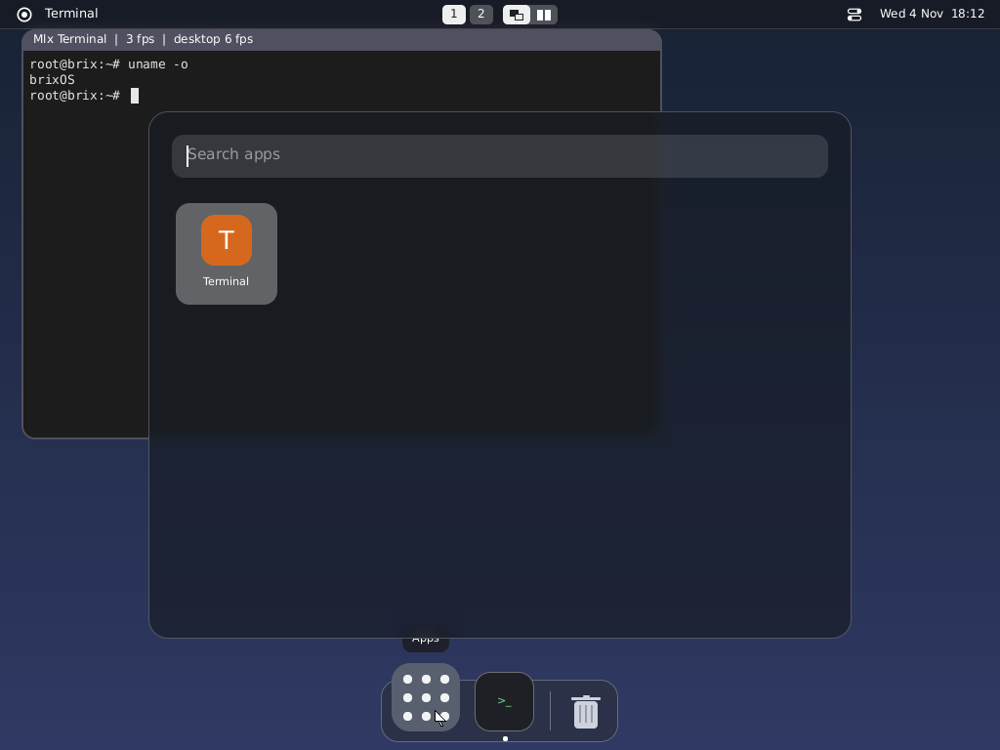

# brixOS kernel

The start of brixOS's kernel, written in Mlx and built by the repository's
own toolchain (mlx4, mlx-ld; no third-party compiler, linker or library).
brixOS is the Stage 4 target of AGENT_IMPLEMENTATION.md; its normative
requirements are spec/04-stdlib/os/brix.xml:

- native first: its own handles, waits, memory maps, processes and IPC;
- std.posix translates the POSIX semantics programs need onto them;
- a Wayland-capable byte-stream transport with handle passing, shared
  memory export/import and poll/wait integration, so that std.wayland's
  public API stays the same on Linux, BSD and brixOS.

## What runs

brixOS boots in QEMU (`-kernel`, Multiboot), says itself on the serial
line and starts impulse as its first process (the init below: it runs
flux on the serial line and, on a display, the boot screen and then
the virtual console), the programs of its boot archive (the coreutils)
as processes of their own, on a file system in memory with brixOS's own
layout and copy on write:

    ./mlx build brix           # also mlx-out/bin/brix/disk.img (64 MiB)
    qemu-system-x86_64 -m 512M -cpu max -display none -serial stdio \
        -kernel mlx-out/bin/brix/brix.img \
        -drive file=mlx-out/bin/brix/disk.img,format=raw,if=virtio
    tools/check_brix.sh        # the same, typed at, checked

With `-smp N`, the kernel finds the processors in ACPI's MADT and starts
the others through the local APIC (INIT and startup IPIs naming the
trampoline's page, image/ap.mlx, kernel/smp.mlx): they reach long mode on
the boot page tables, take a number each (the trampoline's counter), go
on in the blob's code64 (the kernel's GDT and IDT, a TSS and a block of
their own, layout.PerCpu, as the kernel's GS base: trap stack, arena,
number) and come into the kernel at brix_ap ("brixOS: 4 processors, 3
more started", "brixOS: processor 1 runs"; tools/check_brix_smp.sh). Up
to Memory.MAX_CPUS (8) run the kernel; more stay halted. Each
processor's arena (mlx4's aggregate arena, 4 MiB of the kernel's 32) is
loaded into r14 and r15 at each entry to the kernel; an idle processor,
which stays in the kernel, releases each round of its loop's
(Scheduler.switchTo: smp.arenaMark, arenaRelease).

The kernel runs on one processor at a time: every entry (brix_trap,
brix_ap) takes the kernel lock (smp.mlx; an interrupt while the kernel
waits on the same processor takes it again) and lets it go on the way
back to user mode or while the processor idles (on the boot page
tables, halted until an interrupt). The processes run beside each
other: a ready process is taken by whichever processor looks first (a
running one by none other: State.running), with its registers, SSE
state, page tables and FS base; a processor keeps its own current
process. The first processor's time slices come from the PIT, the
others' from their local APIC timers (vector 0xF0, calibrated against
the clock at boot); the PIC's interrupts (the serial line, the disks)
reach the first one only, so another processor polls a disk request.
On the way out of the kernel a processor that leaves a process runnable
(ready, or a blocked one whose wait is over) while another idles wakes
that one with an IPI (Vector.WAKE); an idle processor also looks again
at its timer's tick. A process ending or the shell restarting on one
processor leaves the processes running on others alone (they end as
usual).

or from UEFI (OVMF's firmware in QEMU; on a machine, the same file as
EFI/BOOT/BOOTX64.EFI on a FAT partition):

    qemu-system-x86_64 -m 512M -cpu max -display none -serial stdio \
        -bios /usr/share/ovmf/OVMF.fd \
        -drive format=raw,file=fat:rw:mlx-out/bin/brix/esp
    tools/check_brix_efi.sh    # the same, checked

brix-image writes an EFI application when its output ends in .efi
(image/efi.mlx): a PE32+ file with the Multiboot image in it and a
loader in front that does a Multiboot loader's part (the UEFI memory map
passed through as a Multiboot memory map, so the kernel maps all of RAM,
the ranges above the hole and above 4 GiB included; the display's
framebuffer from the Graphics Output Protocol into the boot info,
ExitBootServices, out of long mode, the image to 1 MiB, the blob's
entry). The kernel's console
stays the serial line; the screen is mlx-console's (below).

    brixOS: kernel at 0x200000, 292 KiB
    brixOS: 511 MiB (415 free), 2076 MHz
    root@brix:~# seq 3 | sort -r | tr "\n" " "; echo
    3 2 1

The programs in the image are built for brixOS (`--target=x86_64-brixos`,
into mlx-out/bin/brix): `@import("builtin").os` is `brixos` in them, so a
program asks at compile time which system it is for (`uname -o` says
brixOS), and std picks its `X.brixos.mlx` files (std.platform). They
still call the kernel by Linux's system call numbers.
    root@brix:~# ls /
    devices  system  temporary  users
    root@brix:~# cd /temporary; cat /system/programs/flux > a
    root@brix:/temporary# stat -f -c "%f free" .; cp a b; stat -f -c "%f free" .
    37627 free
    37617 free

## The system on the disk

The boot image holds the kernel and an archive (flux, the tools, the
coreutils) that the first boot runs from. `install` in brixOS puts the
system onto a brixfs volume (`brixfs format /devices/disk0; install`:
/system, /users and /temporary copied to /volumes/disk0, committed), and
from then on the kernel boots from the disk: a volume with
system/programs/flux on it is the system, its /system, /users and
/temporary are the tree's (vfs.graft: the same nodes as
/volumes/disk0's; the memory-only ones go), programs run from the disk
and what is written stays. The boot archive's /system is at
/volumes/boot then (`install` installs from there again). "brixOS: /
from /volumes/disk0 (the boot archive at /volumes/boot)" says so;
tools/check_brix_system.sh does it, boots again twice and reads what it
wrote. /devices and /volumes stay the memory-only tree's.

## The layout

brixOS does not use Unix's directory layout (the FHS); its directories
are named for what they hold:

    /system/programs   the programs (the boot archive; read-only bytes,
                       copied into pages of their own when written)
    /system/settings   the system's settings: users, groups, init/services
    /devices           console, tty, null, zero, disk0, disk1, ... (the
                       virtio disks), framebuffer, keyboard, mouse
    /system/fonts      the fonts of the boot archive (DejaVu Sans Mono)
    /users/root        the user's home (the shell starts there)
    /temporary         scratch space (init/control, the init's FIFO;
                       logs/NAME.log, the services' output;
                       screen-picture, the last frame of the program
                       that left the screen, for the one that takes it)
    /volumes           each disk's volume (diskN: brixfs, or ext2
                       read-only) and the brixfs volumes' snapshots

Linux programs (all the repository's programs are, for now) expect some
of Unix's paths. The system call layer, not the tree, maps them:
`/tmp` → /temporary, `/dev` → /devices, `/etc/passwd` and `/etc/group`
→ /system/settings/users and groups, `/proc/self/exe` → the program the
process runs. `ls /` shows only brixOS's own directories.

A program's crash report (std.crash) is the host's there: with no
/proc/self/maps and no /proc/self/comm, the program's own file (what
/proc/self/exe links to) says where its segments are and what it is
called, and is read into memory for its symbol and line tables; mincore
says which of the stack's and the arena's pages are there
(tools/check_brix_crash.sh runs the host's crashing program under flux
and holds its reports to the host's).

Besides files and directories the tree holds symbolic links (a link's
target is its data; `Vfs.walk` follows links in the middle of a path,
and the last one unless lstat, readlink, O_NOFOLLOW or O_CREAT|O_EXCL
ask for the link; 40 at most, then ELOOP) and FIFOs (mkfifo, mknod: a
pipe while one is open; a read waits for the first writer, a write for
the first reader; O_RDWR waits for no one). Both are stored on brixfs too.

All 73 programs of projects/coreutils are in the boot archive;
tools/check_brix.sh runs each, about 180 invocations with their options
(tools/brix_programs.sh), in brixOS and on the host and compares what
they print.
It also runs projects/brix/tools/floats (a long computation in the SSE
registers) twice at once: both must print the host's result, so each
process keeps its registers across the timer's preemptions; and
projects/brix/tools/signals, a line for each step of what signals do
(handlers, masks, sigtimedwait, EINTR and SA_RESTART, sigsuspend, a
fault on the alternate stack), which must print what it prints on the
host.

## Memory and the machine's figures

The kernel hands out all of the machine's memory as 4 KiB frames, from
Memory.FREE (112 MiB: the image, up to 80 MiB, and the kernel's arena
come first) on, in
spans: the Multiboot memory map's RAM regions (the one below the hole
under 4 GiB, the ones above it, where a machine with more than 4 GiB has
most of its memory). The BIOS loader and the EFI loader both pass the
map through, so an EFI boot maps all of RAM too, not only the RAM below
the hole. The boot tables map the first GiB
into the kernel's view (KERNEL_VIRTUAL + physical); the kernel maps the
rest itself as it starts (kernel/memory.mlx, mapRest: a page directory
of 2 MiB pages for each GiB with RAM under the boot PDPT, which every
address space shares; nothing for the hole), up to 64 GiB (a u16 count
per frame, who holds it, in 32 MiB of counts at most). QEMU's -m 4G
gives 4095 MiB, 3 below the hole and 1 above it, and a program writes
and reads 3.5 GiB back. A process's pages are made on
first use (a fault makes the page and the next of its region, 16 in
all: a fault costs far more than zeroing a page under emulation, and a
program growing into its memory faults once in 64 KiB rather than once
a page), copied on write after a fork, shared by memory objects; a
processor loads a process's page tables only when they are not the ones
it has (Space.activate: writing CR3 drops the whole TLB, and a process
going on after a system call or a tick is in its space still; a space
whose pages were just made copy-on-write is flushed, and a process that
ran on another processor last is loaded anew there); a
program that asks for more than there is gets null from mmap, and the
runtime says "out of memory" on stderr before the program's own report.

`system_info` (spec call 52, std.os.brix.systemInfo) says what the
machine has and what the kernel did: the memory and what is free of it,
the processors running the kernel, the uptime, and the kernel's counts
since the boot (page faults served, system calls, switches between
processes, the interrupts the devices sent as messages), and how long
processors waited for the kernel while another held it. `sysinfo`
prints them:

    memory: 2047 MiB, 1938 free
    processors: 2
    uptime: 6.0 s
    page faults: 3229, system calls: 822, switches: 14
    device interrupts: 57
    waits for the kernel: 41.220 ms in all; the longest 2.104 ms (behind process 7 in brixOS call 17); in the last 10 to 20 s 0.310 ms (behind process 3 at fault 14)
    idle processors' waits for the kernel: 12.007 ms

The waits are those of processors that had something to run: a program
that stutters behind another's call (a driver waiting for its device, a
long copy) shows there, with the process and the call that held the
kernel for most of the wait. The second line sums the waits of
processors that had nothing to run (their ticks queue behind whoever is
in the kernel and delay nobody). Nothing is measured where the kernel is
free when asked for; tools/check_brix_smp.sh runs `sysinfo` on four
processors.

std.build's runner takes its memory figures from it on brixOS (on Linux
from /proc/meminfo), and build.mlx says what the big compiles take
(Build.memory: the desktop's programs 350 to 420 MiB each), so `mlx build
brix -j 2` in brixOS runs two jobs where they fit and one where they do
not. tools/check_brix.sh runs the native test program's system_info
line; tools/check_brix_build.sh builds the brix group in brixOS on 2 GiB
with two jobs.

## Copy on write

A physical page counts who holds it (`Frames.share`, `Frames.free`):

- fork shares every page of the parent with the child, read-only and
  marked copy-on-write in both; the first write (by the program, or by
  the kernel for a system call: CR0.WP is on) copies the page, or takes
  it back writable when it is the last holder (`Space.copyOnWrite`).
- Files share pages: copy_file_range and the FICLONE ioctl share whole
  pages between files (`Vfs.copyRange`), and a write to a shared page
  copies it first (`writableBlock`). std.fs.copy (cp, and every copy of
  std) tries copy_file_range first, which on Linux gives reflinks on
  btrfs and XFS. A copy of a 570 KB file costs a few pages instead of
  139.
- The archive's programs are pages of the boot image until written.

## Snapshots

`snapshot SOURCE DESTINATION` (projects/brix/tools/snapshot, in
/system/programs) makes a copy of a tree at once, whatever its size: new
directories, files that share every page with the originals
(`Vfs.cloneTree`); a write to either side copies the page. `-r` makes it
read-only (changes fail with EROFS), `-d SNAPSHOT` takes one out. The
copy is built before anything names it, so a snapshot may go inside its
source: `snapshot -r / /users/root/before`. Restoring is a snapshot back.
The tool calls brixOS's own system calls 1000 (SNAPSHOT) and 1001
(REMOVE_SNAPSHOT), past Linux's numbers. (Hard links inside a tree become
separate files in its snapshot.)

## The disks

The virtio block devices (QEMU's `-drive ...,if=virtio`, up to four) are
found on PCI bus 0 at boot (`Pci`, pci.mlx), in the bus's order, and are
/devices/disk0, /devices/disk1, ..., block devices of their sizes:
programs read and write them at any byte offset (`head -c 9
/devices/disk0`, `echo text > /devices/disk1`); what is written is on the
disk image. Each disk's volume is mounted at /volumes/diskN (a brixfs
volume, read and written, or an ext2 one read-only); the first with a
system on it becomes / (below). A volume on another disk is formatted
and used alike (`brixfs format /devices/disk1`, then /volumes/disk1;
`sync` commits every volume); disks may share an interrupt line. A
disk with a GPT (block.mlx reads it: the header's and the entries'
CRC32s checked) is /devices/diskN with its partitions /devices/diskNpM
(from 1), each a volume of its own at /volumes/diskNpM (the disk itself
is then no volume); `brixfs partition /devices/disk3 2 1` writes a GPT
with partitions of those sizes (MiB) on a device or an image (a boot
later sees them).
tools/check_brix_disks.sh boots with three disks (a brixfs system, an
empty one formatted and written in brixOS, an ext2 image). The driver (`VirtioBlock`, virtio.mlx)
uses the legacy PCI transport (registers in an I/O BAR), one virtqueue in
pages of its own, one request at a time through a bounce page; the
processor halts until the device's interrupt (its PCI interrupt line, the
PIC's IRQ 11 in QEMU, taken back through the ISR register) says it is
done ("brixOS: disk0 answers by interrupt" at boot). The process that
asked still waits inside the kernel meanwhile: no other one runs until
the request is done.
While a volume is mounted from it, a /devices/diskN is not writable.

A large disk costs what is done on it, not what it is. The store keeps a
map of the blocks in use (projects/brix/blockmap.mlx: a bit a block, 15
MiB for 500 GB) with the count of them, so the free room is a
subtraction; a free block is found by stepping over full words; a commit
frees just the blocks it replaced, where it walked every root of the
volume before (volume.mlx, "free blocks", says why that is safe, and
when a walk is still made). The kernel says at each mount how long it
took ("brixOS: disk0: a brixfs volume of 131072000 blocks, 131071996
free, read in 46 ms (its roots walked in 3 ms, 6 blocks read)"), and
`volume PATH` what the store did since (projects/brix/tools/volume, on
volume_info, call 56: commits and their times, walks, blocks read and
written; `volume --check PATH` has the map compared with a walk over
every root; the check below builds it, the boot image does not hold it
yet).
tools/check_brix_bigdisk.sh does it on a sparse 500 GB image: the mount
and a thousand status questions within bounds, the free count against the
host's `brixfs check` (which holds a volume of any size and counts the
blocks in use), a small disk filled and emptied, six thousand files made
in one go with a snapshot of them and a file of 600 MiB read after a
restart (the store's loops let go, each round, what they made in the
kernel's arena: kept, it ran out and the kernel stopped), the machine
cut off.

## On a real machine

Beside virtio, the kernel drives what a board has (a Supermicro H11 with
an EPYC is the one it is brought up on; QEMU's q35 machine with `-device
ahci`, `nvme`, `igb` and `qemu-xhci` stands in for it,
tools/check_brix_q35.sh, check_brix_usb.sh, check_brix_net_igb.sh):
SATA disks on every AHCI controller (ahci.mlx), NVMe namespaces
(nvme.mlx), an Intel igb network controller (igb.mlx), USB boot keyboards
and mice on every xHCI controller, also behind hubs (usb.mlx: there is no
PS/2 there). Each wait is a deadline on the clock (clock.Deadline), never
a count of register reads, which is a blink on one machine and minutes
on another, and each step that fails says so with what it saw ("ahci:
port 4: the device stays busy (SSTS ... TFD ...)", "usb: port 3.2: the
device takes no address (completion code 4)"). A controller is taken
from the firmware first where it says it holds it (AHCI's BOHC, xHCI's
USB Legacy Support). A device's registers are mapped by
`memory.Device.map`: below 511 GiB at the kernel's direct offset, beyond
(a 64-bit BAR the firmware put high, as OVMF does with the xHCI's) in a
window of the kernel's own.

The network controller and the USB controllers raise their interrupts as
messages (MSI, or MSI-X where a controller has only that: `Pci.enableMsi`,
`Pci.enableMsix`) to vectors of their own on the first processor's local
APIC (layout.Vector.NET, USB; trap.mlx ends each at the local APIC): a
received frame and a keyboard's report are served when they come. The
timer tick looks at both as well, so a machine where no message arrives
(no MSI capability, a local APIC that is off) works as before, a
hundredth of a second later at most; `sysinfo`'s "device interrupts" says
which it is, and /system/settings/interrupts with the word `polled` in it
keeps every device to the tick (for a board whose messages are in
doubt). The disks' commands are waited for where they are issued
(the kernel runs a call to its end), as before.

USB devices may be plugged in and pulled out while the system runs. Every
port, a controller's or a hub's, goes through the same states a step at a
time (usb.mlx `Port`: settling, reset, recovery, bring-up); the boot runs
these steps until every port rests, afterwards the tick and the
controller's interrupt do, and the waits in between are deadlines a step
looks at, so the kernel is held only for a command's or a request's round
trip. A hub says which of its ports changed on its status endpoint. A
device that goes gives its slot and its memory back, a hub's devices
with it, and a keyboard's held keys are released. What the kernel has
to say about it afterwards is in its log (/devices/klog), not on the
console.

The picture's mode is the monitor's own where the firmware can set it:
the loader (image/efi.mlx) reads what the monitor says of itself (its
EDID: the firmware's EDID Active protocol on a handle whose Graphics
Output Protocol is the one in use or shows the same picture's memory;
the first timing is the mode it prefers; an interlaced one's lines are
doubled, its count being one field's), finds that size among the
firmware's modes and sets it, instead of taking the mode the firmware
was left in (often a smaller one, or one of another shape that the
monitor stretches). Only the EDID of the display in use counts (a server
board's management controller has a display of its own), and on the
monitor's word the loader never goes to a picture of fewer pixels than
the firmware's. When the firmware lacks the mode (a card's firmware
often has no 3840x1080 for a wide monitor), the loader takes, of the
modes no wider and no higher, the one that shows most of a picture of
that shape (1280x960 before 1280x1024 on such a monitor), if that is
more than the firmware's own mode shows: still stretched, but less; the
monitor's own mode then takes the card's driver, for which the loader
passes the EDID itself on to the kernel (its base block and first
extension block, 256 bytes at layout.Blob.EDID; Info.EDID_BYTES says how
many there are). An image may name a mode
itself: a file settings/display in the archive, "3840x2160" (that mode,
or the nearest below it) or "firmware" (the firmware's, come what may);
brix-image builds the loader for it. The kernel's log says what
happened: the display it got, whose mode the loader set and what the
firmware's was ("brixOS: the loader set this mode, the nearest the
firmware has to the monitor's own; the firmware's was 1024x768"), what
the monitor says when the picture is another, a mode the firmware
refused, the firmware's modes, and how many graphics outputs it offers.
The shape of the screen goes on to the programs: /devices/framebuffer's
geometry ends with it as a width and a height (the monitor's own mode
when it says one, else the mode the loader looked for, else the
picture's own size), and where the picture is of another shape the kernel
says so ("brixOS: the picture is shown on a screen of the shape
3840:1080 (the monitor's own mode); ..."). The boot screen draws for that
shape and is round on a monitor that stretches the mode
(projects/desktop/splash, tools/check_brix_shape.sh); the desktop does
not yet (text brought together would not be readable: it waits for the
monitor's own mode). That the monitor stretches is taken, not known: the
kernel cannot see what the monitor does with a mode. One that shows it in
the mode's own shape, with borders, gets a boot screen too narrow by as
much, and so does a monitor behind a switch that answers with an EDID of
its own. Nothing in the image says the screen's shape by hand yet:
settings/display names a mode, and the monitor's word goes before it;
ignition takes --screen WIDTH:HEIGHT, which the init does not pass.

A machine may have more than one graphics adapter (a board's own and a
card in a slot), and a monitor on each. All of them are the system's:

- The loader goes through every graphics output the firmware offers
  (image/efi.mlx, CODE_MORE). The first is handed over as ever (the boot
  info's FB_* fields); every further one that has a picture of its own in
  memory the kernel can write gets a record in a page of the image
  (layout.Blob.DISPLAYS, layout.More; seven at most) with its
  framebuffer, size, pixel order and its monitor's EDID where the
  firmware has one, and the mode set that the first one's part would
  set (the one the image names, else that monitor's own, the nearest the
  firmware has). An output that shows another one's memory again (the
  console's own in front of a card's) is that display, not a new one; one
  without pixels (the console's own output over two cards, a virtual
  adapter that only takes blocks) is passed over and counted, also
  when it is the one the firmware lists first (the displays are then
  the outputs behind it). A loader
  before this one leaves the count of records zero, and a kernel before
  this one does not look at them: either pair comes up with the first
  display, as before. A Multiboot loader hands over none (the kernel sets
  the Bochs adapter up itself): one display.
- The kernel lists them (kernel/displays.mlx reads the boot information,
  kernel/display.mlx keeps them), a line each: its number, its size, where
  its memory is, which PCI adapter's memory that is, its node:

      brixOS: the firmware offers 3 graphics outputs: 2 displays, 1 without pixels the kernel can use (passed over)
      brixOS: display 0: 1024x768 at 0xc0000000, PCI 04:00.0 1a03:2000, /devices/framebuffer1
      brixOS: display 1: 1280x960 at 0xe0000000, PCI 21:00.0 1002:67df, its monitor says 3840x1080, /devices/framebuffer, the main display (its monitor names the largest mode of its own)

  (They are numbered in the firmware's order; "its monitor says" is
  there when the firmware passed the monitor's EDID on. A further
  display's lines on the mode the loader set follow its line, as
  "brixOS: display 0: the loader set this mode, ...".) Its own console (the boot log, a stop's report) is on every one of them
  (fbcon.mlx: a grid for each one's size), until a program maps that
  display's node.
- One display is the main one, /devices/framebuffer: the one whose
  monitor names the largest mode of its own (its EDID, as the firmware
  passed it on: a monitor that says what it is is plugged in; a board's
  remote console says nothing), else the one with the largest picture, of
  several alike the firmware's first. An image may name it: a line
  "main N" in settings/display (N the display's number as the log says
  it), or "main VVVV:DDDD" (its adapter's PCI vendor and device, which
  holds whatever order the firmware lists them in), beside the mode's
  line or alone ("monitor" is the mode's default, said). The log says
  which and why, and says when the line names none that is there.
- The others are /devices/framebuffer1, /devices/framebuffer2 and on:
  the same ten words to read (width, height, pitch, format, the screen's
  shape, then the display's number, how many there are, the adapter's
  vendor and device) and the same pixels to map.
- What draws on the screen draws on all of them: ignition, kepler and
  mlx-console show the main display's picture on each further one too,
  fitted to its size without distortion: as large as it goes in the
  shape it was drawn in (a pixel of the frame is square there, also on a
  further display whose monitor stretches its mode: that display's own
  shape is counted in), with black bars where the shapes differ
  (std.displays). A main monitor that stretches a mode of another shape
  (1280x960 across a 32:9 screen) shows the desktop wider than it was
  drawn; the further display shows it as drawn. They name what of
  their frame changed, after the main display has it; a pixel of a
  further display is the mean of its part of the frame; and what waits
  is brought for 2 ms of a frame's time at most, the rest when the
  program is at rest: a second display costs the main one that much of
  a frame while the whole screen changes, and nothing while nothing
  does. An extended desktop (each display its own part) is not there
  yet.
- The Radeon's driver works on the display in its own card's memory
  (gpu.mlx `ownDisplay`), which need not be the main one, and takes that
  display's monitor's EDID.

tools/check_brix_displays.sh starts the EFI image under OVMF in QEMU
with two adapters of different sizes (a Cirrus VGA, 800x600, and a
second standard VGA, 1280x800) and dumps both screens: the log's lines,
the boot log, the boot screen and the desktop on both, a window opened
arriving on both, the main display named, the virtual console made
larger on the other, and one adapter beside one without a framebuffer,
either way round.
tests/476_boot_displays_runtime.mlx reads boot informations with none,
one, two, eight and too many displays and tries the rule;
tests/477_displays_fit_runtime.mlx the fitting and the bringing.

The machine is started by UEFI (EFI/BOOT/BOOTX64.EFI, image/efi.mlx) and
often has no serial line, so the kernel's messages are also drawn on the
firmware's framebuffer (fbcon.mlx: an 8x16 font, a grid of characters so
that a scroll never reads the adapter's memory back, the framebuffer
mapped write-combining) until a graphical program maps it, and kept in a
log (/devices/klog; klogsave writes it to boot.log on the brixfs
volumes and keeps the boot before's beside it as boot.previous.log: what
the kernel said in a boot that ended with a dark screen is read after
the next one). `console.screen(false)` keeps a long dump off the screen (in
the log and on the serial line only). A fault of the kernel's own stops
it with a report on the screen (trap.mlx `stop`: what, where, the
registers, the callers), drawn over whatever is there.

The log is handed to another computer of the same network, without a
reboot and without a photograph, by logserve
(projects/brix/tools/logserve). It is no service: a person starts it at
a terminal when there is something to hand over, and ends it with
Ctrl+C.

    logserve [PORT]

answers HTTP on the port (8080) and says where: "open
http://10.10.36.57:8080/all on another computer of this network" (the
link's address; a link without an address yet or without a cable is
said, and the address when it has come). A browser or curl there gets

    /all                 everything below in one text, a heading line
                         ("==== /klog: ... ====") before each part and
                         "==== end ====" after the last: the one to copy
                         and send
    /gpu                 the log's lines that begin with "gpu:" (the
                         graphics driver's read-out)
    /gpu.rom             the graphics card's video BIOS ROM as the
                         kernel read it at boot (/devices/gpurom): not
                         a text, a file to save and send
                         (`curl -o gpu.rom http://ADDRESS:8080/gpu.rom`)
    /klog                the kernel log, whole
    /boot.log            the files of these names at the top of the
    /boot.previous.log   mounted volumes, where klogsave writes (a
                         megabyte of each at most; in /all, a boot.log
                         that is the beginning of the log above is
                         named and not repeated)
    /system              what sysinfo says, and each network link's
                         record in words
    /                    a page that lists these

and nothing else: the pages are these fixed ones, read-only (a
request's path is never opened as a file, every other path is 404,
methods other than GET and HEAD are refused), and nothing is written.
While it runs, everyone on the network can read the log; it says so
when it starts, and each request in a line. Where the other computer
cannot reach the machine, the machine connects out and writes the /all
text:

    nc -l 9000 > brix.txt                (on the other computer)
    logserve send 192.168.1.20 9000      (in brixOS: its address and port)

It uses brixOS's own socket calls and the one wait: several clients at
a time, each within time limits, so one that says nothing or stops
reading keeps nobody waiting. Each turn of its loop gives back the
values it made (std.turns), and a text asks the machine before it
grows: where there is no memory for an answer the client is told so
(503) and logserve goes on (tools/check_brix_logserve.sh, on virtio
and igb; tests/461_logserve_runtime.mlx).

The loader hands the kernel the ACPI tables' root from the firmware's
configuration table (a UEFI firmware keeps none in the BIOS area), so the
other processors are found and started there too (smp.mlx: the XSDT, the
MADT's local APIC and x2APIC entries). The local APICs are reached the
way the firmware left them: their registers in memory, or, in x2APIC
mode, as model-specific registers (IPIs with 32-bit ids, the timer, the
end of an interrupt); this second way is written to the manuals and has
not run anywhere yet (QEMU's emulation here has no x2APIC).
/system/settings/processors (a number) limits how many run the kernel.

    tools/brix-diag-efi.sh

writes two images for such a machine beside the build's: BOOTX64-diag.EFI
(no graphical session: the kernel's log stays on the screen to be read or
photographed) and BOOTX64-console.EFI (mlx-console on the screen: a
shell with the USB keyboard; `cat /devices/klog` shows the log). Both
run on one processor and carry the GPU's firmware.
(tools/brix-native-efi.sh makes the images that ask the GPU's driver for
the monitor's own mode: below.)

The GPU (gpu.mlx: an AMD Radeon, Polaris) is found and its register path
tried; its driver is built in stages, and what the next ones stand on is
there: its apertures in the kernel's view, memory in one piece for what
the card reads and writes (`gpu.dma`), its firmware from the boot
archive by name (`Archive.find`), a vector for its interrupt
(layout.Vector.GPU, `Pci.enableMsi`, `smp.localApic`). The firmware's
picture is the console and the desktop's screen: the file's head says
what must not be done to the card while it is, and where to read that
the usual boot writes no register of the display.

Its display controller (DCE 11.2) is read at every boot, and set only
when the image asks for it (gpu_display.mlx reads, gpu_mode.mlx plans,
gpu_set.mlx writes; the register numbers and fields are those of Linux's
dce_11_2_d.h, dce_11_2_sh_mask.h, vid.h and gmc_8_1_d.h, looked up there
and held against them by tools/check_gpu_registers.py; only a Polaris
card's is read, on another AMD card the same numbers are other
registers and the log says that it is not read). For every
controller that is on the log says the timing (the size shown, the
totals, blanking and sync), the primary surface (its address in the
card's memory, pitch, extent, control word), the viewport and what it
is to fill, the scaler (mode, taps, ratios, borders) with the line
buffer before it, the encoder it goes out by (DisplayPort with its
lanes, or TMDS) and the frames it counts in a second with the pixel
clock that follows (measured: the PLL's dividers are not read). Then
one line says what it shows:

    gpu: controller 0 shows 3840x1080 from a picture of 1280x960: the card scales
    gpu: controller 0 shows a picture of 1280x960 as it is: the monitor is sent 1280x960

Numbers that do not fit together (a total smaller than what is shown, a
viewport that is not the firmware's picture, an address outside the
aperture) are not concluded from: "gpu: the read-out is not plausible
(...): the register map needs correcting".

The monitor's own timing is its EDID's (edid.mlx: the detailed timings
of the base block, of a CTA-861 and of a DisplayID extension block; the
monitor's own size is its preferred timing's, and of the timings of that
size the one with the lowest rate of 50 Hz or more is taken, which asks
least of the link; an interlaced one and one for stereo glasses are
passed over):

    gpu: the monitor's own timing is 3840x1080 at 60.00 Hz: pixel clock 266640 kHz, h 3840 4000 (front 48 sync 32 +), v 1080 1111 (front 3 sync 10 -)

(OVMF has no EDID for QEMU's display. tools/check_brix_efi.sh tries the
loader's way all the same: a test image's loader gives the firmware an
EDID first, `brix-image --test-edid=FILE`. Where the loader passes none
on, the kernel takes the Bochs adapter's own, QEMU's `-device
VGA,edid=on,xres=3840,yres=1080`.)

From the read-out and that timing the kernel makes a plan and says it
(for the card that shows the picture the kernel draws on: where the
firmware's console is another adapter's, the EDID is that one's
monitor's and nothing is planned).
There are two situations. (a) The controller runs the monitor's own
timing and the card scales the firmware's small picture: a picture of
the timing's size needs a surface of that size, the viewport, the scaler
off, and for the long rows the line buffer's whole memory, more buffers
and safe urgency marks, on the running controller. (b) The controller
runs the small picture's timing: the pixel clock, the timing and the
stream have to be set too. That is planned for DisplayPort, where this
controller makes the pixel clock by a DTO (a phase over a modulo: two
registers), and only when the link the firmware trained has room for the
new clock (lanes times rate times 8/10 over the bits a pixel; the rate
is not in a register of its own and is worked out from the stream's M
and N and the pixel clock). A link
that is too slow would have to be trained again, which is the card's
firmware tables' work and not there yet.
On an HDMI or DVI output (TMDS) the pixel clock is a PLL's and is the
link's clock too: the output is taken down, the PLL set, the timing set
and the output brought up again, and the PLL, the transmitter, the
timing and the controller's stop and start are the work of small
programs in the card's own video BIOS ROM (below), which Linux runs for
them and so does the kernel. Such a plan is made at every boot, table
runs among its writes, and is complete only when everything is as the
sequence needs it: the ROM read and its tables there in the revisions
their parameters are known for, the ROM naming the connector behind the
encoder, the controller's clock being that encoder's PLL's, a timing the
link carries. The monitor's own timing is taken when a TMDS link carries
it without scrambling (HDMI below 340 MHz, below 300 MHz unless the ROM
says the output may send more, and no more than the monitor's EDID names
as its highest clock; DVI signalling to 165 MHz); when not, another of
the EDID's timings of the same size that it does carry (the lowest rate
of 50 Hz or more, else the highest), and the log says which and why.
The signalling: DVI for a clock a DVI link carries when the firmware's
picture is sent that way (the monitor has shown it takes that), HDMI
above it when the monitor's EDID has the HDMI block (as Linux chooses);
RGB at eight bits, no pixel sent twice.

    gpu: plan (a): the controller runs this timing already; a picture of 3840x1080 at 0x500000 of the aperture, the scaler off: 38 writes would do it
    gpu: plan (b, DisplayPort): the link has 4 lanes at 2.70 Gbit/s (by M 0x3333 over N 0x8000), room for 360000 kHz at 24 bits: 266640 kHz fits
    gpu: plan (b, DisplayPort): the pixel clock from 108000 to 266640 kHz (the DTO's phase from 108000000 to 266640000), the timing, the stream stopped and started, a picture of 3840x1080 at 0x500000 of the aperture, the scaler off: 63 writes would do it
    gpu: the monitor says it is an HDMI one, up to 300 MHz
    gpu: plan (b, TMDS): HDMI signalling at 266640 kHz (now DVI at 107960 kHz), the clock's PLL, the timing and the transmitter by the card's own tables, a picture of 3840x1080 at 0x500000 of the aperture, the scaler off: 7 table runs and 86 writes would do it
    gpu: plan (b, TMDS): nothing would be set: table SetPixelClock is revision 1.6 in this ROM: what it is told is known here for content revision 7 only

The plan's steps, a line each ("gpu: would write 1b9d = 00000100 (the
controller's picture blanked)", "gpu: would set 4e47 & 00070000 =
00030000 (the back end's mode)" for a field set in the word as it then
stands, "gpu: would run SetPixelClock with a0 af 28 00 18 21 03 00 ...
(the pixel clock's PLL set)" for a table with the bytes it is told),
what a TMDS plan found on the way ("gpu: DIG 4 is UNIPHY E; the ROM puts
a connector of the kind "HDMI" behind it, hot plug line 2 ...", the
clock and timing the way back would ask for, the firmware's scratch
words, what the output carries, the display clock), the table runs of
the way back ("gpu: on the way back would run ...") and the registers
themselves ("gpu: raw 1b80: 00000f9f ...": a register's number, then its
value and those of the registers after it) are in the log only
(/devices/klog, boot.log); a shell shows them by themselves with

    while read l; do case "$l" in "gpu: raw"*|"gpu: would "*|"gpu: on the way back"*) echo "$l";; esac; done < /devices/klog

The steps' order and locks are those of Linux's display core
(gpu_mode.mlx names the function each one follows, and says where Linux
hands a step to the firmware's tables and the registers are written
directly instead). (The read-out's own "next stage" and "would set"
lines are the stage's before; the plan says more.)

None of this writes to the card, and none of it runs a table of the
card's. A plan is carried out only by an image whose archive has a file
settings/gpu with the word `native`; the word `rehearsal` there asks for
less (below).

    tools/brix-native-efi.sh

makes both from the build's image: mlx-out/bin/brix/esp/EFI/BOOT/
BOOTX64-native.EFI and BOOTX64-rehearsal.EFI are BOOTX64.EFI with that
one file more (`brix-image --add`), and BOOTX64-diag-native.EFI and
BOOTX64-diag-rehearsal.EFI the diagnostic image likewise when
tools/brix-diag-efi.sh has made one. With the file, and a plan that is
complete, the kernel carries the plan out before any program runs
(gpu_set.mlx): the new picture's memory is cleared, each write is read
back, each state waited for has its time, and afterwards the
controller's frame counter must run at the planned rate and the memory
interface must not say that it ran dry. When anything of that fails the
firmware's state is put back, every register from the value read before,
and the log says what failed and what came back. When it holds, the
kernel's display is the new picture from there on: the console is drawn
again on it, and /devices/framebuffer gives the programs the monitor's
own size.

A TMDS output's plan is carried out with more care still, since the
card's own tables do part of it and nobody has seen them run here on a
card: a table that does not run to its end, or runs to it and wrote
nothing, ends the change; so does a transmitter or a controller that
does not follow its table, a controller that is not on the encoder's
PLL after the pixel clock's table, timing words that are not what the
timing's table was told, and frames that do not count at the planned
rate while the transmitter is still off (a PLL cannot be read: there its
clock is measured, before the monitor is sent anything). The way back is
the same sequence towards the firmware's state: the tables are told the
firmware's timing, signalling and clock (the clock as it was measured,
in whole 10 kHz), and every register the kernel wrote itself gets the
firmware's value again. What cannot be read back is said as such: the
PLL's and the transmitter's own settings are then what the tables made
for that clock. The screen is dark while the output is down (a tenth of
a second at least, so that the monitor sees the signal gone); what each
table did, each state waited for and how long it took is in the log
alone. How long it can be dark at most is bounded whatever the card
does, and said before the first write: a state is waited for a tenth of
a second at most and a table is given two seconds and no more, which
for seven tables comes to "the screen is dark meanwhile, 18 s at most
(and 18 s more at most if the firmware's state has to be put back)".
After that the kernel goes on starting in any case.

On the machine, in three steps, each only after the one before held.

1. The build's own image (or the diagnostic one, where the log stays on
   the screen). Nothing is written. The "gpu:" lines say whether there
   is a plan: on the screen the monitor's timing, the controller's
   lines, the video BIOS's line and "gpu: plan (b, TMDS): ... 7 table
   runs and 86 writes would do it", or "nothing would be set: ..." with
   the reason. If there is none, or before going on in any case, send
   the log and the card's ROM (logserve's /all and /gpu.rom, or boot.log
   and gpu.rom from a brixfs volume): with the ROM every table the plan
   runs can be run on the host first, against Linux's own interpreter
   (tools/check_atom_reference.sh), where a table this interpreter
   cannot run costs nothing.
2. BOOTX64-rehearsal.EFI: the firmware's own mode set again by the same
   steps (the plan line then begins "gpu: plan (the firmware's own mode
   set again): ..."). The screen goes dark for a moment and comes back
   as it was. Nothing new is asked of the monitor; it shows that the
   card's tables run here, that the output goes off and comes back and
   that the checks hold on this card. The line that says so: "gpu:
   controller 0 runs the firmware's own mode again, set by the card's
   tables, ... the picture is where it was". (It does not show that the
   PLL takes another clock: the one asked for is the one that runs.)
3. BOOTX64-native.EFI: the monitor's own mode. The desktop at the
   monitor's own size is the success; the log says "gpu: controller 0
   shows a picture of 3840x1080 as it is, ... the monitor's own mode is
   set (7 table runs, 86 writes, each read back)".

If it fails and the picture comes back, the screen says why ("gpu: step
24 of 108 failed (...): run SetPixelClock with ...") and what came back
("gpu: the firmware's state is back (...)"). If the screen stays dark:
wait until the disk is quiet (the system goes on starting behind the
dark screen, and klogsave writes that boot's log), then restart into the
normal image, which never writes to the display: klogsave has kept the
dark boot's log as boot.previous.log on the brixfs volumes (`cat
/volumes/NAME/boot.previous.log`, or logserve's /boot.previous.log; the
boot after that one overwrites it, klogsave run again by hand does not).
That file is what to send back, whole: its "gpu:" lines say each table's
run and where one stopped ("gpu: table SetPixelClock (...) was stopped
after too long at 0x... of the ROM (opcode ...)"), each state waited
for, the frames counted with the output off and the timing's words as
the table left them, and at the end one of four things: the firmware's
state is back (said only when everything the way back looked for was
there and the controller counts frames as before); it is NOT known to be
back (every register the kernel wrote has the firmware's value again,
but something the way back looked for was not there, a transmitter that
did not come on after its table, say: "gpu: on the way back, not as it
should be (the way goes on): ..." names each); it is NOT all back, with
the registers that differ; or "the way back did not come to its end: the
output is left as that left it until a restart", after a table that
could not be run on the way back either. A screen that stays dark although the log says the monitor's own
mode is set means the monitor does not take the signal: nothing comes
back from a monitor on a TMDS link, so the kernel cannot see that; the
log with the plan's lines is what to send then too.

Not done yet for a TMDS output: a clock of 340 MHz and more (HDMI
scrambles there and the monitor has to be told over its DDC lines; there
is no I2C here), two DVI links, more than eight bits a colour and YCbCr,
audio, a monitor plugged in later or another one (the plan is for the
monitor the firmware showed its picture on), and a way to take the new
mode back when the monitor shows nothing though every register is right
(someone would have to confirm the picture; the kernel sets the mode
before there is a keyboard). The tables that Linux runs once at its
start and this driver leaves to the firmware's own start (the
transmitter's "init", the power gate) are not run.

tests/452_gpu_display_readout_runtime.mlx reads the same from tables of
numbers on the host, tests/459_edid_timing_runtime.mlx reads EDIDs
written from the standard's layout, and
tests/460_gpu_mode_set_runtime.mlx holds both register plans' writes
against the sequences worked out from Linux's code, on a card that is a
table and can fail at every step. For a TMDS output
tests/474_gpu_tmds_sequence_runtime.mlx does the same with a ROM whose
tables write down what they were told: the whole change, write for write
and run for run, the way back from a failure at every step, tables that
write nothing, do not end or cannot be run, the rehearsal; and
tests/475_gpu_tmds_blocks_runtime.mlx holds what each table is told byte
for byte against the bytes worked out from Linux's atombios.h and
command_table.c, the timing and signalling chosen, and every reason for
no plan.

On this controller Linux does not write the pixel clock's PLL and the
transmitter itself: it runs small programs out of the card's own video
BIOS ROM (AtomBIOS command tables: SetPixelClock, the transmitter's and
the encoder's control and others). So does the kernel, for a TMDS
output's plan and only when the image asks (gpu_blocks.mlx has what
each table is told).

The ROM is read at every boot (gpu_rom.mlx), by the first of three ways
that gives one that holds: the copy the card's UEFI driver leaves in the
ACPI table VFCT (memory is read, nothing of the card); the PCI expansion
ROM (the PCI configuration's ROM word is written to learn its size and
to switch it on, and put back); the card's own ROM registers (the
management controller's index and the ROM's index are written, and put
back). No register of the display is touched, and gpu_rom.mlx's head
says why the picture cannot mind. Nothing of it depends on the slot the
card sits in or on the card being the firmware's display: the firmware's
copy is found by the card's place on the PCI bus, the expansion ROM is
switched on only at an address inside the window of the bridge before
the card (not at one a firmware merely left behind), and where there is
neither, the ROM registers give it. On a machine with a second adapter
(a board's own) the log says whether the firmware's picture is in this
card's memory or another adapter shows it; a card the firmware has not
started at all has its ROM read and kept, and nothing else of it is
read or set. A ROM holds when it begins 55 AA, has
AMD's mark and an "ATOM" header inside its length, as Linux asks, and
when its bytes add up to 0, which Linux does not ask: one whose bytes do
not add up is kept to be looked at and none of its tables is run. The
screen says which way gave it and what names it, and which of the
ROM's connectors the running controller goes out by (the numbers here
are a test's, not a card's):

    gpu: video BIOS from the firmware's ACPI table VFCT: 2048 bytes, "TEST ROM FOR BRIXOS", part number 113-TEST-001, of 2026/11/11 12:34
    gpu: controller 0 goes out by the ROM's connector 0: HDMI (transmitter UNIPHY E, DIG 4; hot plug pin 4; DDC line 4)

and the log alone (/devices/klog, logserve's /gpu) a line for each
table a mode set runs with its revision ("gpu: table SetPixelClock
(12): there, revision 1.7"), the firmware information's clocks ("gpu:
firmware information: the pixel clock PLL's reference 100000 kHz, ...")
and each connector with its transmitter, hot plug pin and DDC line
("gpu: connector 1: DisplayPort (transmitter UNIPHY A, DIG 0; ...)"),
read as Linux's display core reads them.

The ROM's bytes are the file /devices/gpurom. They are the best test
there is for the next stage, so they are easy to hand over: logserve
gives them as /gpu.rom, and klogsave writes them as gpu.rom beside
boot.log on the brixfs volumes for a machine without the network.

The tables are run by an interpreter of our own (atom.mlx: every opcode
and argument kind of Linux's atom.c, bounded on every side: nothing is
read outside the ROM, a run has a count and a time, calls a depth; a
run that fails says the table, the offset and the opcode). The card is
reached through hands the kernel fills: hands that only read stop a run
at its first write and say what it would have written, and the hands
that write do so only in an image that asks for the monitor's own mode.
(With the setting off no table is run at all, not with hands that only
read either: gpu_set.mlx's head says why.)
Since the card cannot be tried in a VM, the interpreter is proven on the
host: tests/472_atom_interpreter_runtime.mlx runs tables assembled by
hand, tests/473_gpu_rom_runtime.mlx reads ROMs the test makes (damaged
ones too) by all three ways, and

    tools/check_atom_reference.sh LINUX

builds Linux 6.6's own atom.c as a program of the host (LINUX: where
its files lie; none is in this repository) and runs thousands of
generated tables through both interpreters on the same card that is a
table, holding every register read and write, every wait, the
parameters afterwards and the end of each run side by side;
`--mistakes` shows that it notices mistakes put into the interpreter on
purpose, and `LINUX ROM TABLE:WORD,WORD...` runs a real ROM's tables
through both (for the machine's own ROM, once it is handed over).
tools/check_gpu_registers.py holds the numbers of both files, and of
the parameter blocks, against Linux's.

What is not there yet: disks served by their interrupts (AHCI, NVMe: a
command is waited for), USB devices other than boot keyboards, mice and
hubs.

(The font's glyphs were a `const` array, a value built where it was
used: each row of each character drawn built all 1520 bytes of it in the
kernel's arena, which was full after 173 characters. That, not a driver,
was the freeze after "probing storage". The table is a `var` now, and
mlx4 reads a `const` table from static data as well.)

## The network

A virtio network device (QEMU's `-netdev user,id=n0 -device
virtio-net-pci,netdev=n0`) is /devices/net0 (`VirtioNet`,
virtionet.mlx: the legacy transport, a receive queue with buffers posted
ahead and a transmit queue, on a virtqueue of their own, virtqueue.mlx);
"brixOS: /devices/net0, 52:54:00:12:34:56 (virtio, IRQ 11)" at boot.
The kernel's stack (kernel/net) runs on it:

- stack.mlx: Ethernet, ARP (a table of the neighbours, a request when
  one is missing: the packet waits for the answer, four packets at a
  time, the neighbour asked three times a quarter of a second apart;
  when nobody answers what waited is dropped, and an echo request's
  ping socket is told in ICMP's words, "host unreachable" from the
  machine's own address), IPv4 (one address, netmask and gateway; no
  fragments; 127.0.0.0/8 is the machine itself: what is sent there
  comes straight back in, from the address it was sent to, with or
  without an address of the network's, a link, or a network device at
  all, and never goes onto the wire; what is sent to everyone,
  255.255.255.255 or the subnet's last address, goes to everyone's
  hardware address without a question, and what comes so addressed is
  for datagram sockets alone: a TCP segment or an echo request to
  everyone is not answered, and a stream's connect to such an address
  or to a group's is refused as invalid) and ICMP (echo answered).
  What cannot leave the machine as it is (reach.mlx works it out from
  the configuration: no device, the link down, no address, no gateway
  to it) is not tried: a socket's connect or send says unreachable at
  once. The
  addresses are /system/settings/network's (`address`, `netmask`,
  `gateway`, `nameserver` lines) or DHCP's. Until one of them gives an
  address the stack has none: it sends nothing but DHCP's messages
  (from 0.0.0.0), takes nothing but DHCP's answers and answers no ARP
  request. What the file or DHCP's answer leaves out is none: without
  a gateway only the own subnet is reached (a send or a connection to
  anywhere else is unreachable), without a name server resolv.conf has
  no line and no name is looked up; a netmask left out is the one of
  the address's class, and a file whose netmask line is none (a hole
  in its bits, or 0.0.0.0) is not used at all ("brixOS:
  /system/settings/network is not used: 255.0.255.0 is no netmask";
  DHCP asks). The kernel writes /system/settings/resolv.conf for
  programs that look names up, and says at boot "brixOS: net0 is
  10.0.2.15, gateway 10.0.2.2, name server 10.0.2.3 (DHCP)" (without
  "(DHCP)" for the file's; "none" for a gateway or a name server there
  is not). The link is looked at on every tick of the timer
  (netdev.mlx): when it goes or comes the log has a line ("net0: the
  link is down", "net0: the link is up, 1000 Mbit/s full duplex", with
  the frames that were not sent meanwhile when there were some), while
  it is down nothing is handed to the card, and when it comes the
  neighbours are forgotten and DHCP begins again. At boot a link that
  is not up yet is waited for, half a second at most (QEMU's igb has
  it a third of a second after its start), so that the first programs
  find it up.
- udp.mlx, tcp.mlx: datagrams; connections (active and passive open,
  segments of MSS bytes within the peer's window from a send ring,
  sent again after a timeout that doubles, data received in order into
  the socket's ring and acknowledged at once, FIN both ways, RST; no
  selective acknowledgement, no slow start). A connection its program
  closed still sends what is left and waits for the peer's end; one
  that stands still for 20 s with nothing on its way is reset (a peer
  that never closes its side, or takes no more, would keep one of the
  sockets for good). What is asked of a listener and not made yet (its
  SYN came, our SYN+ACK went) is a record in halfopen.mlx's table and
  takes no socket: 64 of them at a time for the machine, the one that
  waited longest giving way to a newcomer; the SYN+ACK goes again
  after one and three seconds, and after seven the record is dropped.
  The peer's ACK makes the connection, which waits in the listener's
  queue (16 at most; while it is full a SYN gets no answer) until the
  program accepts it. (The queue was 4, counted together with what was
  only asked, and a connection asked took a socket for 71 seconds:
  four SYNs nobody followed up kept a listener deaf for that long.)
- sockets.mlx, api.mlx: the sockets a process's descriptors name
  (files.Kind.socket; 128 at most, a 16 KiB ring each), and what a call
  does to one. A call that has to wait leaves the process waiting for
  the socket to change (WaitKind.socket), as reads of pipes do. The
  connections a listener took do not hold its port: a program that
  listened and ended can listen there again at once.
- rings.mlx: the rings' memory (16 KiB in frames one after the other),
  kept for the next socket when a socket goes: frames in a run come
  only from memory never used before, so a ring freed frame by frame
  was lost for every later ring (after 32 connections for each free
  MiB no socket could be opened).
- linux/socketcalls.mlx: Linux's socket calls (socket, connect
  (EINPROGRESS and SO_ERROR for a non-blocking one, as std.net makes
  them), bind, listen, accept, sendto, recvfrom, shutdown, the names and
  options) on AF_INET: std.net, std.net.dns (resolv.conf and hosts at
  std.platform's paths) and std.http.client run unchanged, so does
  wget (projects/wget: `wget URL [-O FILE]`, http and https).

- lease.mlx, dhcp.mlx: unless the settings give an address, DHCP asks
  for one (RFC 2131). lease.mlx is the client and knows no kernel (its
  clock and its wire are two functions, so tests/455_dhcp_lease_runtime
  drives it on the host); dhcp.mlx puts it on the kernel's clock and
  UDP and does to the stack what it says. DISCOVER goes at boot (the
  boot waits half a second for the answer) and again after 1, 2, 4, 8
  and then every 16 seconds for as long as nobody answers, and at once
  when the link comes up. With an address held, the link coming up
  asks for the lease anew at once, of everyone (the cable may be in
  another network now; again after 1, 2, 4, 8 and 16 seconds while
  nobody answers): an ACK renews it, a NAK gives the address up, and
  without an answer it is kept until the lease ends. The
  ACK's address, netmask, router and name server are the configuration.
  The lease's time and its T1 and T2 are the answer's (options 51, 58,
  59; half and seven eighths of the lease without them, or where they
  do not lie in order inside the lease, or T1 is no seconds): at T1 a
  REQUEST goes to the server from the own address, at T2 to everyone,
  each again after half of what is left (a minute at least); when the
  lease ends or a server answers NAK the address is given up (the
  stack has none again) and discovery starts from the beginning. A
  lease for ever is not renewed. When the answer comes after the boot
  has said "net0 has no address yet (DHCP is asking)", the kernel says
  "brixOS: net0 is ..., gateway ..., name server ... (DHCP)" then, on
  a line of its own, and again only when a renewal changes the
  configuration; an address given up is "brixOS: net0 gave up
  10.0.2.15: its lease ran out (DHCP is asking)" (or ": the DHCP
  server took it back"). settings.mlx reads the network file and
  writes resolv.conf.
- native/sockets.mlx: brixOS's own socket calls (spec calls 39 to 46:
  socket_open of a stream, datagram or ping socket, bind, connect,
  listen, accept, send, receive, info; std.os.brix's socketOpen and
  the rest). A call never waits: it says would_block and the program
  waits on the handle (READABLE, WRITABLE, PEER_GONE, ENDED). A packet
  to our own address goes through the stack at once (a loopback), so a
  program may talk to itself; a machine without a network device has
  sockets too, for 127.0.0.0/8. A connect or a send that cannot leave
  the machine as it is says unreachable (status 27; ENETUNREACH on the
  Linux layer), at once: the link's record says which of the reasons
  it is, and wget says it ("cannot connect: this machine has no
  address", "... the network link is down", "... this machine has no
  network device", or that no gateway leads to the host). It was a
  connection tried for over a minute, and would_block for a datagram.
- ping (projects/ping): `ping [-c COUNT] HOST` (an echo request a
  second until Ctrl+C or COUNT of them; a line for each reply with its
  time, one for each request without an answer, then the loss and the
  least, mean and greatest time), on a ping socket by brixOS's own calls
  (host.brixos.mlx: socket_open's kind 3, the one wait, the interrupt
  event; host.mlx is Linux's datagram socket of IPPROTO_ICMP). The
  kernel sets the identifier and gives the socket its replies, and
  ICMP's word that a request was not delivered: a router's, or the
  kernel's own when nobody said the hardware address the request was
  to go to (ping then says "no answer from 10.10.36.9 (its hardware
  address is not known: nobody answered for it)", or names the
  gateway). The destination is the address given with the send (its
  port means nothing); unreachable says the request cannot leave the
  machine as it is (the link is down, there is no address yet, no
  gateway leads there), would_block that the device is busy: ping
  tries again for the request's second and then says which it was
  ("seq=7 could not be sent: the network link is down"; the link as it
  is then, so a cable that comes out during a run shows request by
  request); the summary counts such requests apart ("0 sent, 0
  received, 1 could not be sent"). 127.0.0.1 is answered from
  127.0.0.1, also on a machine without a network device. A request
  that went and stays without an answer while the link is down says
  so ("no answer for seq=7 (the network link is down)"); a reply from
  another address than the one asked is marked
  "(not the host asked)". A reply's time is from before the request
  was handed to the kernel. A name that cannot be looked up is said
  with the reason (no name server set, none answered, the server
  answered that it cannot look names up, no such name, no name at
  all), and, where no server is set or none answered, with what
  stands in the way on this machine's side (the link down, no address
  yet). Each request's second gives back what it took of the value
  arena (std.turns): ping left running does not grow.
- link.mlx: the link's state for programs. /devices/net0 is a node of a
  kind of its own (as /devices/framebuffer is the display's): a read
  gives the link's record as things are at that moment (spec
  `<NetworkLink>`, 72 bytes with its length first: whether the cable is
  in (igb's status register, virtio-net's status word), DHCP still
  asking, where the address is from (nowhere yet, DHCP, the settings
  file), the speed where the card says it, the hardware address, the
  driver's name, the address, netmask, gateway and name server
  (0.0.0.0: none), the frames received and sent, and the seconds
  DHCP's lease still runs and was given for). The record was 64 bytes
  before the lease's two words: a program that asks for 64 gets those
  as they were. std.os.brix's `networkLink(index, &link)` reads it
  into a struct. A machine without a network device has no such node.
  Until DHCP has answered the record has no address, and the boot line
  is "brixOS: net0 has no address yet (DHCP is asking)".

The settings app's Network page (projects/desktop/settings,
network.brixos.mlx) shows that record for every link, read again every
two seconds: connected or no cable, the address with its prefix length
and "by DHCP" or "from the settings", gateway and name server ("None"
where there is none), how long DHCP's lease still runs, hardware
address, driver, the frames; and how to give a fixed address
(/system/settings/network, read at boot). Nothing is changed from the
page yet.

The top bar reads the same records (projects/desktop/topbar,
network.brixos.mlx, in the place of the Linux bar's nexus and
/sys/class/net) once a second on its tick: its control centre's network
tile shows "Ethernet" with the address, lit, for the first link that has
a cable and an address, else "No address yet", "No cable" or "No device";
the tile's symbol stands as a sign on the bar, left of the control
centre's toggles; a click on the tile opens the settings on the Network
page (there is nothing to switch). The bar is drawn again only when
that changed, and under a compositor run with --verbose it says so
("horizon: network: net0 connected, 10.0.2.15"; tools/check_brix_nettile.sh
pulls the cable, and boots without a card and without a DHCP server).

tools/check_brix_net.sh boots with the user network: DHCP, ping as a
person types it (tools/brix_ping_cases.sh, which the igb check goes
through too: a neighbour not spoken to yet, whose first request the
kernel keeps until its hardware address is known, the gateway, an
address nobody has, the machine itself, a name, the count's forms, two
at once, forty in a row, Ctrl+C; QEMU's capture of the frames says
where the echo requests went), wget fetching files (a small one, a 400
KiB one, a missing one) from an HTTP server on the host, the native
calls (a stream to ourselves, a datagram, an echo; a stream and a
datagram to 127.0.0.1), and the link's record as netcalls reads it,
with the lease; then again on a wire without a DHCP server (no address:
nothing but DHCP's questions is on the wire, a datagram sent to
everyone is not heard, resolv.conf is empty, 127.0.0.1 is reached all
the same), with the cable out until after the boot (the address said
when it comes), on another network (192.168.76.0/26: the record has
what that DHCP server answered), with a fixed address in the settings
file (the first packet through its gateway answered), with an address
line alone (no gateway, no name server: the own subnet and nothing
else), with an address line of 0.0.0.0 (that is no address: DHCP
asks), with a netmask line that is none (the file not used), without a
card (ping 127.0.0.1, the native calls and logserve asked by wget all
the same; anywhere else unreachable), and on a network of the
check's own (tools/brix_lan.py at the other end of QEMU's socket
network: a name server, also deaf to a first question and unable to
look a name up, replies later than a second, a reply twice, one from
another address, a neighbour slow to say its hardware address, a
router that says a host cannot be reached, also of one that answers, a
host and a gateway nobody answers for; the subnet's address for
everyone; a name whose IPv6 question the name server drops, which is
not asked: std.net.dns asks for AAAA records only on a system that has
IPv6 sockets; and a listener, in raw frames: a connection asked of
everyone is not answered, and behind 4 and behind 100 more connections
begun and never finished a real request is answered within two
seconds).
tools/check_brix_net_igb.sh does the cable pulled and put back (also
while a ping runs: the kernel's lines, what cannot be sent said at
once, the lease asked for anew), the late answer on the igb card, and
a ping at the first prompt with a fixed address.
tools/check_ping_linux.sh runs ping's Linux build on the loopback of a
network namespace of its own, and watches that it does not grow while
it runs. tests/455_dhcp_lease_runtime.mlx runs the
lease's renewal and end on a clock of its own (QEMU's user network
gives a lease of a day, and its length cannot be set).
tools/check_brix_desktop.sh opens the Network page and pulls the cable.
tests/464_net_reach_runtime.mlx and tests/465_tcp_half_open_runtime.mlx
run reach.mlx (the netmask's rule, everyone's addresses, the way a
packet takes) and halfopen.mlx (the table's rules) on the host.
Not yet: IPv6, a second link, the configuration changed while the
system runs.

## brixfs: the disk's format

brixfs (projects/brix/brixfs.mlx, the format; kernel/volume.mlx, the
kernel's side; tools/brixfs, the tool) is copy on write: nothing in use
is written over.

- Blocks of 4 KiB. Blocks 0 and 1 are superblocks taking turns; the
  valid one (its checksum right) with the higher generation is the
  volume. It names the inode table's root block, the next inode number
  and the snapshot table.
- The inode table: a root block of 512 inode block numbers, 16 inodes of
  256 bytes each (format version 2). An inode names its owner and group.
  A file's data is named by extents (a run of blocks: where in the file,
  how many, where on the disk): 12 in the inode, else in a block of 256
  (depth 1) or in up to 512 such blocks one block names (depth 2), so a
  file written in one go is one extent; a directory's data: 64-byte
  entries (inode, name); a symbolic link's: its target; a FIFO has none.
- A commit writes what changed into free blocks: of a changed file the
  pages written since the last commit (each page of the tree carries a
  changed mark), the rest keeps its blocks, and its extents are made
  again (`Store.writeFile`: an extent goes on while the next block
  follows the last on the disk); a changed directory whole; the inode blocks with changed
  inodes, a new table root; then, between two flushes of the device
  (virtio's FLUSH when it offers it), the other superblock with the next
  generation. Until that one block is written the disk is the last
  commit, whole; after it, the new one.
- Free blocks are those no root reaches (the current one, the
  snapshots'): marked again at mount and after each commit. The same
  sweep notes the current table's free inode numbers; new files take the
  lowest of them before a number never used.
- A snapshot is the current root kept in the snapshot table:
  `snapshot -r /volumes/disk0 /volumes/NAME` commits, keeps the root and
  mounts it read-only at /volumes/NAME; `snapshot -d /volumes/NAME`
  takes it out (its blocks are free unless the volume still uses them).

In the tree, /volumes/disk0 is the current state. Nodes are read from
the disk when first used (`Vfs.ready`: a file's data at once, a
directory's entries as nodes not read yet); a change marks a node
(`Vfs.touch`); a node made in the tmpfs and linked into the volume
becomes the volume's (`Vfs.adopt`); moves between the volume and the
rest of the tree are EXDEV. Commits happen when the system is idle (every
process waits, e.g. at the shell's prompt) and at sync, fsync, syncfs.
The tree's nodes come in page-sized chunks made as they are needed (no
fixed count; `Vfs.grow`), and the tree is a cache: after an idle commit
(`Store.trim`), while more nodes are in use than its budget (one for
every 256 KiB of memory, 512 at least), clean directories read from the
disk are unloaded (the nodes they name freed, subdirectories first;
nothing open, changed or linked twice goes), and while less than a
quarter of memory is free, clean files' pages are dropped; both are read
again when used. stat
gives a volume node's inode number and the volume as its device.

    brixfs format /devices/disk0     on brixOS (it is mounted at once), or
    brixfs format disk.img           on the host (mlx-out/bin/brixfs)
    brixfs create disk.img 64        a formatted 64 MiB image (one that
                                     is there is kept; ./mlx build brix
                                     makes mlx-out/bin/brix/disk.img so)
    ext2 make disk.img 8 DIRECTORY   an ext2 image of a host directory
                                     (mlx-out/bin/ext2): brixOS mounts
                                     an ext2 disk read-only at its
                                     /volumes/diskN (kernel/ext2.mlx;
                                     Linux's images too, 1-4 KiB blocks)
    brixfs list disk.img             every path and size, the snapshots
    brixfs cat disk.img docs/a       a file
    brixfs blocks disk.img docs/a    a file's block numbers (0: a hole)
    brixfs check disk.img            the volume checked (the table, every
                                     inode's extents in range and no
                                     block in two files of one root,
                                     entries naming inodes that are
                                     there, link counts; the snapshots'
                                     roots too); also on brixOS, on
                                     /devices/diskN while mounted
    brixfs repair disk.img           checked, link counts mended in a
                                     new commit

A directory of 64 entry slots or more is looked up through an index
made at its first lookup (`Vfs.buildIndex`: hash slots in frames, two
for each entry slot, probed in order), kept up as entries are added,
and dropped with the directory's entries (unloaded, or when a chain
grows long: made again at the next lookup). The entries on the disk
stay a list.

Users: a process runs as a user and a group (0, the system's, at boot;
setuid and setgid, which only the system's user may use to become
another: `as USER[:GROUP] PROGRAM` of the tools does), new nodes are
theirs, chown changes that (an owner only the group), and the kernel
checks modes (`Vfs.permits`: read, write, execute for the owner, the
group, the rest; the system's user may everything but run what no bit
lets anyone run) when a path is walked (execute on each directory), a
node is opened, made, removed, renamed, run, or its mode and times are
changed (the owner's); the Linux layer says EACCES or EPERM, brixOS's
own calls denied. Owner and group are on the disk with the inode.

Not there yet: a directory is still written whole when an entry changed;
nodes held open or with more than one link stay in memory; no journal of
small writes between commits (a crash loses what came after the last
one, never more).

The pieces:

- **mlx4 `--target=x86_64-freestanding`**: the program's `_start` takes
  its value arena from rdi (base) and rsi (end) instead of mapping one,
  calls `main` and halts; no system call is made by the generated code.
  The code is position independent, so the kernel runs where the boot
  maps it (the higher half).
- **brix-image** (projects/brix/image): one file QEMU (or any Multiboot
  loader) boots. The first MiB is the boot blob: its code is AT&T
  assembly (blob.mlx, ap.mlx, efi.mlx) assembled by mlx-cc's assembler
  (compiler/cc/asm.mlx, through assemble.mlx: the layout's numbers as
  `.set` constants, the parts at their offsets by `.org`, the kernel's
  _start, brix_trap and brix_ap by relocation), its tables written by
  brix-image: the Multiboot header, the boot info the kernel reads
  (layout.mlx `Info`), GDT, TSSs, IDT, the 32-bit entry (page tables for
  the first GiB at 0 and at 0xFFFF800000000000, long mode), the 64-bit
  start (higher half, IDT, TSS, SYSCALL MSRs, SSE), the SYSCALL entry
  and a stub per vector. Then
  the kernel's segments (at 2 MiB) and the archive of files
  (`BRIXFS01`: name, offset, size; `NAME=FILE` and `DIRECTORY/`
  arguments, sorted by name), up to the kernel's arena at 64 MiB.
- **The kernel** (projects/brix/kernel), Mlx without std, written as
  types that hold their functions and constants (`Space.map`,
  `Process.load`, `Terminal.read`, `layout.Op.OUTB`); the state is a few
  module variables of those types (the frames, the process, the
  terminal, the clock), reached through functions (`process.current()`):
  - cpu.mlx: mlx4 has no privileged instructions, so the kernel asks the
    blob for them by SYSCALL from ring 0 (`Port`, `Cpu`, `Msr`,
    `BootInfo`: port I/O, CR2/CR3, INVLPG, WRMSR, RDTSC, entering user
    mode); the entry tells the kernel's calls from the program's by the
    return address's half.
  - serial.mlx, console.mlx: `Uart` (COM1: output polled, input by its
    receive interrupt) and `Console` (`console.out`).
  - interrupts.mlx: `Irq`, the two 8259 PICs moved to vectors 32 to 47
    with only the timer (the PIT's channel 0, 100 Hz) and the serial
    line unmasked; end of interrupt, spurious IRQ 7 and 15. The kernel
    runs with interrupts off (trap gates and SYSCALL clear IF): they
    come in user mode, or while the idle loop halts.
  - memory.mlx: `Page`, `Frames` (physical frames from the Multiboot
    memory size, with the count of their holders), `Space` (an address
    space sharing the kernel's half: map, translate, back, release,
    write, clone sharing its pages, copyOnWrite, destroy).
  - vfs.mlx: `Vfs`, the file system: a tree of `Node`s in memory (a
    tmpfs). A file's data is in pages (12 direct, an indirect page, a
    double indirect one; shared between files, copied on write), a
    directory's in 64-byte entries; a node lives while a directory names
    it or a descriptor holds it. The tree at boot is the layout above.
  - linux/filecalls.mlx: `FileCalls`, the calls on paths (relative to the
    working directory or a directory's descriptor): open/creat with
    O_CREAT, O_EXCL, O_TRUNC, O_APPEND, stat/statx, access, getcwd,
    chdir, mkdir, rmdir, unlink, rename, link, truncate, chmod, utimensat,
    statfs, getdents64, copy_file_range; `Compat`, Linux's paths onto
    brixOS's; /proc/self/exe (a shell runs scripts by it).
  - archive.mlx, elf.mlx: the boot archive's files; a static ELF
    program in any file of the file system, its segments copied into an
    address space.
  - process.mlx: `Process`: a program from the archive (a static ELF, as
    mlx4 and mlx-ld write them) in its own `Space`, its stack (argv,
    envp, auxv), break, anonymous mappings and stack as `Region`s of
    pages made on first touch (page faults, or the kernel preparing a
    range it is handed), its `Descriptors`, its pid, parent and group,
    what it waits for, and its registers while it does not run.
  - scheduler.mlx: `Scheduler`, the table of processes: fork (the
    pages shared copy-on-write, `Space.clone`), the end of a process (a zombie
    until its parent's wait4; SIGCHLD to it), signals sent (kill, Ctrl-C,
    Ctrl-\\ and Ctrl-Z to the terminal's foreground group: pending until
    the process runs), job control (a process stopped by SIGSTOP, SIGTSTP,
    SIGTTIN or SIGTTOU waits until SIGCONT; its parent sees it with
    wait4's WUNTRACED and WCONTINUED; a group behind that reads the
    terminal gets SIGTTIN), and the switch to the next process: when it waits, ends or yields, or when
    the timer's interrupt comes in user mode (its time slice, 10 ms, is
    over). A system call that has to wait
    (wait4, a pipe, the terminal, poll, nanosleep, sigtimedwait) leaves
    the process at its SYSCALL instruction to make the call again when
    what it waits for (`Wait`) holds, so no process needs a kernel stack
    of its own; while none can run, the processor halts until an
    interrupt. Each process keeps its SSE registers (FXSAVE's image)
    while it does not run; a new program starts with the default ones.
  - pipe.mlx: `Pipe`s (4 KiB ring buffers, their readers and writers
    counted by the descriptors); files.mlx: `Descriptors` (of nodes or
    pipe ends, with their access mode, O_APPEND, close-on-exec).
  - linux/system.mlx, files.mlx, terminal.mlx, clock.mlx: `System` answers
    Linux's system call numbers (`Number`) and structures for what a
    shell on a terminal needs: read, write, the termios of the serial
    line (`Terminal`: its input queued as the interrupt brings it, Ctrl-C,
    Ctrl-\\ and Ctrl-Z taken at once, so they reach a program that never
    reads; canonical
    mode edited as input comes, with echo, erase and EOF, raw mode,
    ONLCR, ICRNL; the foreground group),
    the window size, fork, execve, wait4, exit, kill, pipe, setpgid,
    umask, mmap/munmap/brk, read/write/lseek on files, poll, clocks
    (`Clock`: the TSC, its rate measured against the `Pit`, the `Cmos`
    clock), uname, getrandom, signals. A call it lacks is said once on the console (`[brixOS: system call N
    not there]`) and gets ENOSYS.
  - signals.mlx: `Signals`, a process's actions (rt_sigaction), mask
    (rt_sigprocmask, rt_sigsuspend), pending signals with their senders,
    alternate stack (sigaltstack). Delivered on the way back to user
    mode: the default action (ignore, stop, or end the process; the shell
    is ended only by its faults and never stops), or the handler on a frame as Linux builds
    it (rt_sigframe: the return to the restorer, the ucontext with the
    registers and the mask, the siginfo, the SSE registers), which
    rt_sigreturn takes back. A system call the process waited in ends
    with EINTR, or is made again with SA_RESTART; pause and sigsuspend
    end with a handler. A fault raises its signal (SIGSEGV, SIGILL,
    SIGFPE, ...), which a handler can take (std.crash's do), else the
    program ends with a report.
  - pci.mlx, virtio.mlx: PCI's configuration space, the virtio disk;
    volume.mlx: `Store`, the brixfs volume (mount, read, commit, sweep,
    snapshots).
  - frame.mlx, trap.mlx, shell.mlx: the trap `Frame` (registers saved,
    SSE state kept by FXSAVE in the blob below it: `Frame.sse`, `Sse`),
    `brix_trap` (system calls and the switches they bring, the timer's
    and the serial line's interrupts, page faults of a process's regions, a crash
    report for the rest: a faulting program ends with SIGSEGV), and
    the first process (impulse, or flux without it), started again
    (every other process ending) when it exits or faults; power.mlx:
    system_power (the volumes committed, the other processors stopped,
    then halt, power off or restart); acpi.mlx: the firmware's tables
    read (never run), for smp.mlx's processors and for the system's end.

The machine is powered off by ACPI's soft off (S5): the sleep type the
DSDT's `\_S5` names, written with the sleep enable bit to the PM1 control
register the FADT names, ACPI mode turned on first where the firmware
left it off. There is no AML interpreter: `\_S5` is a name with a
package of small constants in every table seen, and that one form is
read, inside the table's own length; a package that is not two sleep
types, or two definitions that differ, is not taken (what went to the
register would be a guess). A restart is the FADT's reset
register where there is one, then port 0xCF9, then the keyboard
controller's reset line where there is a controller, last a fault the
processor cannot take. The kernel says at boot what it found:

    brixOS: power off by ACPI: PM1a control at 0x604, S5 type 0 (ACPI mode is off: turned on first, 0x2 to port 0xb2); reset by ACPI's reset register (port 0xcf9, value 0xf)

and at the end each step it takes. A machine whose tables give no S5 (the
line says why) gets the ports of QEMU's chipsets tried, which are also
the last attempt everywhere; one that is still on afterwards says so on
the screen, with the line above and the steps it took (they were said
while a program had the display), and stays halted.

Not there yet: orphaned process groups (a stopped one whose parent
ended stays stopped), TOSTOP's SIGTTOU, other processes running while
the disk works for one, the APIC (the legacy PICs do), groups a user is
in beyond its own, the kernel on more than one processor (the others start
and wait halted).

## brixOS's own interface

brixOS is a Unix in what a person sees, but its kernel interface is its
own (spec/04-stdlib/os/brix.xml): handles with rights instead of
descriptor numbers, one wait over the states of handles with a deadline,
reads and writes that name their position (no cursor in the kernel),
spawn and branch (a copy-on-write copy of a process, as snapshots copy
trees) instead of fork alone, a queue of events and one upcall per
process instead of signal numbers, handlers and masks, groups and
sessions as objects, its own status codes. Its calls are SYSCALL with
NATIVE_BASE (0x4000) + n; Linux's numbers below that are a translation
layer (kernel/linux: system.mlx, filecalls.mlx, errno.mlx) for the
programs built for Linux, and std.posix will be a facade over the native
calls.

A program starts with a start block (spec call 20, 22 and 47): its
arguments and environment (on its stack, as Linux lays them out) and its
handles by role, records of a role and a handle: input 1, output 2,
errors 3, directory 4 (a directory handle: the working directory at the
start), session 5 (the terminal; the first shell's 0 is one), a
spawner's own from 16. process_spawn takes the block and the handles the
child gets (a role names one of them); process_replace takes a block
naming the caller's own; a branch copies the roles; process_start gives
a program its roles as (role, handle) records (std.os.brix: `Start`,
`RoleRecord`, `Role`, `startRoles`, `handleFor`). std.spawn and flux
pass input, output, errors and their session on; the native tool prints
what it got (tools/check_brix.sh).

What there is: kernel/native (calls.mlx, objects.mlx, processes.mlx,
nodes.mlx, streams.mlx): handles (close, duplicate, info), wait, read and
write (at a position or streaming), nodes (open with read, write,
create, exclusive, truncate; info; make a directory, a FIFO or a link;
remove; list), streams (a pipe's two ends), channels (messages of bytes
and handles, which move from the sender's table to the receiver's;
kernel/channel.mlx), memory (map, unmap), processes (spawn a program
with exactly the handles given, branch, replace, exit, take a child's
change, send an event; a process handle's state says when it ended or
changed), events (claim, take, the upcall), the clocks, rename and
snapshots of a tree by its handle (kernel/names.mlx, the core's, which
the Linux layer's rename and SNAPSHOT use too), timers (kernel/timer.mlx:
readable when expired, a read takes the count; native/timers.mlx),
memory objects (kernel/memoryobjects.mlx: pages mapped shared, an entry
bit keeps them shared through a branch), files mapped (node_map: the
file's own pages, copy on write, so every view and the file share them
until one writes), groups (group_join; a group
handle in front of the session, an event to all of it). Native programs
see brixOS's own layout (/temporary; /tmp is the Linux layer's).
std.os.brix for programs; projects/brix/tools/native, events, objects
and kinds show them (tools/check_brix.sh compares their lines). A handle names a slot of the process's table and
the generation the slot had ((generation << 8) | (slot + 1)): a handle
kept past a close stays invalid when the slot is used again. The Linux
layer's descriptors are the slots' numbers, its view of the same table
(handle_of_descriptor gives a descriptor's handle while std moves over).
The core answers in its own Status (status.mlx); the Linux layer turns
it into errno at its edge (linux/errno.mlx).

Events are the core's (events.mlx): Ctrl-C at the session is an
interrupt, a child that changed a child event, a fault a fault event,
with a detail; a kind the program has not claimed takes its default
(end, stop, go on, nothing), a claimed one waits in the process's queue
(events_take) or runs the one upcall (upcall_set; the registers and SSE
registers in a context record on its stack, upcall_return goes back; a
wait it interrupts ends with interrupted). How a process ended or
stopped is an exit code or an event. The Linux layer's signals are a
view of these (linux/signals.mlx): a signal number is an event with the
number as its detail, so it comes back as sent; handlers, masks and
rt_sigframes are the Linux layer's, and wait4's status words its
encoding. A process that has claimed nothing and set no upcall sees its
events that way; and a fault a process has not claimed still goes to a
handler it has there for the fault's signal, so a program that takes
some kinds itself (the compositor its terminate event) keeps the crash
report std.crash installed (tools/check_brix_crash.sh).
projects/brix/tools/events shows the native side.

std on brixOS: a program built with --target=x86_64-brixos reads and
writes its files by brixOS's own calls (std/bootstrap/fs.mlx and
time.mlx go through ./os/host.mlx, which is host.brixos.mlx there: a
platform's file, not `if comptime`, so the compiler's own sources stay
buildable by older compilers and mlx1): std keeps descriptor numbers,
remembers each one's handle and asks again when a close or dup2
made it stale; the clocks are clock_read; _start ends the program by
process_exit (the compiler's x86_64 backend). The native statuses reach
std's callers as the errno values they check, until std's own error
sets replace them. A streaming read of the session from a group behind
gets READ_BEHIND, as the Linux layer's read gets SIGTTIN. Built for
Linux, the same programs keep Linux's calls (the code is the same byte
for byte; tools/check_brix.sh runs the host's side with those builds).
Opening (node_open, its handle's slot the descriptor; flags it has no
word for go to the Linux layer) and reading directories (node_list's
entries as getdents64 records, "." and ".." first, a cookie per
descriptor) are native too; fork/exec still go through the Linux
layer.

## The compiler in brixOS

brixOS builds its own compiler. mlx4 built for brixOS
(`--target=x86_64-brixos`, mlx-out/bin/brix/mlx4) is in the boot
archive, as is tar (projects/tar: tar archives made, listed and
unpacked, plain or gzip, on std.tar and std.flate.gzip). The compiler's
sources come in as an archive: on the host

    mlx-out/bin/tar -czf mlx.tar.gz compiler/selfhost std/src std/bootstrap mlx-out/version.mlx

(the compiler needs std/src beside its working directory and the version
module), served by any HTTP server; in brixOS

    cd /volumes/disk0
    wget http://10.0.2.2:8000/mlx.tar.gz -O mlx.tar.gz
    tar -xzf mlx.tar.gz
    mlx4 -o hello hello.mlx && ./hello
    mlx4 -o mlx4-2 compiler/selfhost/main.mlx && ./mlx4-2 --version

mlx4's target without --target is the system it runs on (brixOS there),
so what it builds runs in brixOS. The compiler it builds is byte for
byte the one the host builds for brixOS. tools/check_brix_selfhost.sh
does this with QEMU (1 GiB, two processors, a 256 MiB brixfs disk; the
self-build takes a few minutes without KVM) and compares the archive's
members, a file's bytes, the program's output and the compilers' bytes.

`mlx build` runs in brixOS too: mlx4's build command compiles
mlx-out/build/runner.mlx (build.mlx on std.build) and runs it, and the
runner starts its jobs as processes (std.spawn's native path, by node
handles) and waits for them by their process handles; the memory
figures come from system_info (two compiles of the compositor's size
need 2 GiB: with less, one job runs at a time whatever -j says), and
without a home directory the result cache is off. build.mlx leaves WebKit's steps out
where projects/webkit/upstream is missing, so the part of the repository
the brix group needs (build.mlx, compiler/selfhost, the assembler's
asm.mlx and base.mlx, std, projects/brix and the programs in the image,
projects/webkit/*.mlx, tools/build-number) is enough:

    cd /volumes/disk0 && tar -xzf mlx.tar.gz && mlx4 build brix -j 2

builds the kernel, brix-image, the tools, the coreutils, the desktop's
programs and the boot image there (the fonts and the keymap from the system's own files, so
the image is the host's). tools/check_brix_build.sh does it (99 steps,
the compositor the largest unit) and compares the kernel and the boot
image with the host's build from the same archive: byte for byte the
same.

## The init and the boot screen

The first process is /system/programs/impulse (projects/init/brixos.mlx,
the same service files as MLX/Linux's impulse; without it in the
archive the kernel runs flux itself, as the checks' own images do).
The kernel gives it the serial console as its input, output, errors and
session, and starts it again when it ends. It reads
/system/settings/init/services/NAME.service (the image carries
projects/brix/settings/init/services: `serial-shell`, flux with
`stdio = /devices/console`; `desktop`, kepler with
`screen = yes`; and `console`, mlx-console for the screen instead,
`disabled = yes`), starts each service with process_spawn and roles of its
own (the terminal named by `stdio` as input, output, errors and session,
the service's group in front of it; else a stream the init reads and
appends to /temporary/logs/NAME.log, or says itself with
`log = console`), waits on everything at once (the processes' endings,
the output streams, the control FIFO, the next deadline: one wait, no
signals), starts ended services again after a growing pause, and ends
the system with system_power (call 50: every volume committed, then
halt, poweroff or reboot; QEMU exits with -no-reboot).

`impulsectl status | start NAME | stop NAME | restart NAME | reload |
poweroff | reboot | halt` asks over the FIFO /temporary/init/control
(one line: the asker's own FIFO, the request); the answer comes on the
asker's FIFO, the text Linux's impulse answers. Only the system may
write that FIFO.

The desktop ends the system through the login service. The top bar's
session menu (under the mark at its left) has Log Out, Restart and Shut
Down, each asking first; the greeter has Restart and Shut Down under its
card. A log out ends the session, and sentinel starts the greeter again.
For the other two the compositor (once the windows were asked to close)
or the greeter calls org.mlx.Login.Restart or PowerOff on the system bus;
sentinel asks the bus who calls (the kernel names the caller's program and
user to the bus: channel_peer) and does it only for the user who holds
the seat, the person logged in or, while nobody is, the greeter's. Then
it ends the seat's compositor and writes `reboot` or `poweroff` to the
init's FIFO. tools/check_brix_session.sh does all of it in QEMU with the
pointer: a refusal (root on the serial console does not hold the seat), a
log out and a second login, a restart into a second boot, a shut down
that ends QEMU, and the kernel's lines about ACPI on q35 and pc.

With a display and ignition in the programs (projects/desktop/splash/
brixos.mlx: the same picture as MLX/Linux's boot splash, drawn by this
one process into /devices/framebuffer), the init starts the splash first,
on two streams (its input: Plymouth's requests as the init sends them,
"U" a service starting, "u" the progress; its output: the answers), and
tells it to quit, keeping its picture, before a service with
`screen = yes` starts, at the earliest 3 s after the splash came up.
`impulsectl message TEXT` puts a line on the splash while it is up
(`impulsectl message` takes it away). A poweroff or reboot shows the
shutdown the same way: the splash in its shutdown or reboot mode, told
each service that stops, fading out before the machine goes.
tools/check_brix_init.sh boots it all: the oneshots, the splash on the
screen, the message, the console's prompt after it (pixel for pixel),
the control, the shutdown screen, the poweroff.

(screenshots/boot.mp4 is the same at 1024x768, recorded through QEMU's
monitor; `uname -o` typed on the PS/2 keyboard at the end.)

## The virtual console

brixOS is usable on a screen: `mlx-console` (projects/console/brixos.mlx,
mlx-out/bin/brix/mlx-console, in the boot image) is the Linux console's
program with brixOS's devices under it: the display's pixels come from
/devices/framebuffer (kernel/display.mlx: the Bochs VBE adapter QEMU
gives a Multiboot boot, set to 1024x768, or the framebuffer the EFI
loader found through GOP, in the boot info; a read gives width, height,
pitch and format, node_map the pixels, 32 bits each, blue first), the
keys from /devices/keyboard (kernel/keyboard.mlx: the PS/2 keyboard's
scancodes by IRQ 1, decoded by the console as a US layout with Shift,
Ctrl, Alt, Caps Lock, the arrows, F1 to F12), and flux runs on a
session pair (spec calls 48 and 49: a terminal of its own, kernel/
terminal.mlx's table; the console holds the control side, the shell the
session as its input, output, errors and session roles; `session_size`
is what TIOCGWINSZ answers). The emulation and the drawing are
std.terminal and std.ui.terminal, the text std.truetype from
/system/fonts/DejaVuSansMono.ttf (the image carries the host's DejaVu
Sans Mono as fonts/DejaVuSansMono.ttf; an archive name with a directory
goes under /system). The kernel itself draws nothing: its console stays
the serial line, where `mlx-console &` starts the screen's.

tools/check_brix_console.sh types on the keyboard through QEMU's
monitor (sendkey), dumps the screen (screendump) and compares it pixel
for pixel with what projects/brix/tools/screen draws on the host for the
same text with the same code and font.

## The desktop

The boot image's screen service is the desktop: `kepler`
(projects/desktop/compositor, the repository's Wayland compositor, built
for brixOS into mlx-out/bin/brix/kepler; settings/init/services/
desktop.service, `screen = yes`, so the init quits the splash for it)
with `vector` as its first client (Alt+Enter; flux on a session
pair in the window). Three things make it run on brixOS's own interface,
each a platform file the compiler picks for `--target=x86_64-brixos`:

- **std.wayland's transport** (std/src/wayland/transport/backend.brixos.mlx)
  carries the Wayland wire over channels: a connection is one end of a
  channel pair (a message a chunk of the byte stream with up to four
  handles, brixOS's SCM_RIGHTS), the compositor's socket is a listener
  node (spec call 51, listener_make: /temporary/wayland-mlx; a client's
  node_open makes a channel and the listener receives its far end as a
  message with one handle, which is `accept`), buffers are memory objects
  (memory_object, memory_map_object, mapped on both sides), and the
  event loops are tables of watched handles waited on with the one
  `wait`. The wire, the protocol code, the clients and the compositor are
  the same code as on Linux.
- **The compositor's backend** (projects/desktop/compositor/drm.brixos.mlx)
  is the brixOS display: the framebuffer (/devices/framebuffer, mapped
  with node_map; the scene composed on the CPU and copied in, with the
  damage), the keyboard (/devices/keyboard: PS/2 scancodes as evdev key
  codes, the modifiers followed from the keys, no keymap sent) and the
  mouse (/devices/mouse: kernel/mouse.mlx, the PS/2 auxiliary port by
  IRQ 12, three bytes a packet, the first with bit 3 set: the buttons and
  the motion, as wl_pointer events). No logind, no DRM, no Vulkan, no
  Xwayland there.
- **std.terminal.pty** opens the terminal's shell on a session pair
  (spec calls 48 and 49) and spawns it natively with roles; std.ui's
  host for brixOS is Linux's (the Wayland client code).
- **The compositor's children** (projects/desktop/compositor/
  children.brixos.mlx) start with process_spawn: the program's node
  (found in PATH), our input, output, errors and session as its roles,
  and for a helper one end of a channel pair as its own role (Role.OWN;
  the helper finds it there, projects/desktop/shared/channel.mlx, and
  reads and sends messages on it; on Linux the same code is a socket
  pair numbered in MLX_DOCK_FD and the like). The children are process
  handles, asked whether they ended at every turn of the loop.
- **The keymap**: brixOS has no XKB data, so the image carries
  /system/settings/keyboard/us.xkb, compiled on the host from its XKB
  data by projects/brix/tools/keymap (brix-keymap, a step of the image's
  build; the entry is left out on a host without the data, and the
  clients then type by their own US fallback), and the compositor hands
  it to its clients (XKB_DEFAULT_LAYOUT picks another file there).

The helpers are in the image and start with the compositor: the top bar
(horizon: the clock, the workspaces), the dock (orbit: the apps
button, the terminal, the trash) and the launcher (launch, shown
by Super or the dock's apps button; it offers the desktop entries of
/system/share/applications, XDG_DATA_DIRS in desktop.service: the
terminal's, projects/desktop/terminal/vector.desktop).

`impulsectl start console` runs mlx-console beside it (console.service
is disabled by default: one program draws the screen; disable the
desktop and enable the console for the plain virtual console).
tools/check_brix_desktop.sh boots the image, sees the compositor take
the screen after the splash with the keymap and the helpers' layers,
opens the terminal with Alt+Enter (its window on the display, the blue
of its title bar counted), types a command through the compositor into
its shell (a file read back from the serial shell), moves the mouse
through QEMU's monitor (the cursor's white counted right of the window),
clicks the dock's apps button (the launcher comes up), starts the
settings app on its Network page (`control network`: what the kernel
says of net0 on QEMU's user network, then "no cable" once QEMU's monitor
pulls it) and powers off. Xwayland is not on brixOS.

The whole picture is the processor's work here, so a frame costs what it
changes: the terminal draws the cells that changed, the top bar's and
the dock's frames are compared with the ones before, and kepler composes
the rectangle a client names (`MLX_FRAMES_SAY=1` in the desktop's
environment says every frame and what was composed for it).
tools/check_brix_draw.sh sees a character typed be two cells drawn and
composed, a minute's turn the clock's digits, the pointer on the dock
less than the dock, and the screen that frames of parts left be, pixel
for pixel, the screen drawn whole after the window was made large and
small again.

The programs carry their product names (projects/desktop and the system
programs): the compositor is `kepler`, the terminal `vector`, the shell
`flux`, the dock `orbit`, the launcher `launch`, the top bar `horizon`,
the login `sentinel`, the greeter `aurora`, the screen lock `umbra`, the
bus `synapse`, init `impulse` and the boot screen `ignition` (the MLX
toolchain -- mlx4,
mlx-cc and the rest -- keeps its name, and so do the MLXIPC protocol and
the MLX_* environment).

The launcher and the dock read **app bundles**, like a macOS .app: a
directory NAME.app under /system/share/apps holding app.ini (the
[Desktop Entry] format) and its own icon.png, so one directory replaces a
.desktop file and a theme icon (projects/desktop/shared/apps.mlx,
projects/desktop/apps). The image ships Vector.app (the terminal), its
icon a dark window with a green prompt. (The boot archive's names were
widened to 72 bytes to hold the bundle paths.)

An app is one thing to the launcher, the dock and the top bar: all three
ask apps.mlx's `find` which entry a name stands for. An entry is found by
its **id**, the app id its program gives its windows (`Id=org.mlx.files`
in Polaris.app's app.ini; a desktop entry's file name), by its own file
name (`Polaris`) and by its StartupWMClass (`polaris`, the program). So
the top bar names a window by its entry's Name, the dock shows it with
the bundle's icon.png (the terminal too: Vector's icon as in the
launcher, no sign of the dock's own), and "Pin to Dock" (the dock's menu,
the launcher's, or the app dragged from the launcher onto the dock) writes
the id into the user's settings, /users/NAME/.config/mlx/dock, where the
next dock finds it. tools/check_brix_apps.sh starts Polaris, Control and
Vector from the launcher and looks at the bar's names, the dock's icons
and the pins (pinned by the dock's menu, there again after the desktop is
started again, unpinned; pinned and unpinned by the launcher's menu, the
latter from a pins file of before that names the app twice; pinned by
dragging), and at an app installed while the desktop runs (all three read
the apps again when an application directory changes, the user's own
/users/NAME/.local/share/apps before the system's);
tests/run_desktop_apps.sh asks the same of apps.mlx on the host.

Two more apps ship as bundles. **Pulsar.app** (projects/desktop/pulsar) is
the task manager: four cards on the window's glass (the processors' load
and its last minute as a curve, the memory, the processes, the time since
the start) above a table of the processes, sorted by any column, each
with its load as a bar of the prism; End process sends TERMINATE, Force
quit KILL. Its figures are the kernel's own, natively: process_list (call
57: a 64-byte record a process, its pid, parent, user, state, processor
time and resident memory, its program's name) and process_open (call 58:
a handle to a process of the caller's user, or any for user 0), to which
event_send ends it. The scheduler counts each process's processor time as
it switches (Scheduler.charge); the memory is its space's present pages
that are not a device's. On Linux the same app reads /proc
(processes.mlx; processes.brixos.mlx is the native path).
**Comet.app** (projects/desktop/comet) is the text editor, on MLX
Observatory's editor model (projects/desktop/shared/editor.mlx, now
shared: initSized gives an app with several documents smaller buffers):
the open documents in the sidebar, the text in a card with its line
numbers, Mlx's tokens in the prism's colours, Find, Save and Save as in
the header, std.ui.chooser for Open. tools/check_brix.sh's native test
lists the processes and opens itself.

**Default apps.** brixOS has no xdg-open; a file opens with the app its
type has (projects/desktop/shared/defaults.mlx). A bundle says which
types it takes (MimeType= in app.ini: Comet text/*, Polaris
inode/directory, Voyager text/html and images); the user's choices are
lines "TYPE = APP_ID" in ~/.config/mlx/defaults.conf, over the system's
/system/settings/defaults.conf (the image's: text to Comet, folders to
Polaris). A double click in Polaris opens a file with its default app;
its menu names it (Open with Comet), offers the other apps that take
the type, and Always open ... with one of them, which writes the user's
line for that type. Control's Apps page starts with Default apps: each
kind of file (text and code, folders, web pages, images, music, videos,
PDF) with the apps that take it, the one that opens it now chosen. Off
brixOS a file no bundle takes still goes to xdg-open, the gateway to the
foreign desktop's handlers.

## The login

Instead of the desktop as root, the boot image can start a login, all on
brixOS's own interface. Three native programs make it, each the same code
as on Linux (the platform the compiler picks for `--target=x86_64-brixos`
decides the few calls that differ):

- **synapse** (projects/desktop/ipc) is MLXIPC, the system message bus,
  on a listener node at /temporary/bus (ipcd.service). Its event loop is
  std.wayland's transport, the native `wait`, not epoll; so the policy
  can tell its clients apart, the kernel names each channel's holder
  (spec call 55, channel_peer: who holds the other end, and its program's
  leaf name), which std.appid reads on brixOS in place of /proc.
- **sentinel** (projects/desktop/login, login.service, `screen = yes`)
  takes the screen after the splash and owns org.mlx.Login and
  org.freedesktop.login1 on the bus. It starts the greeter compositor
  (`kepler --greeter aurora`) by branching (process_branch),
  taking an unprivileged identity (spec call 53, identity_set: a
  process's user and group, which its children inherit, down from 0 for
  good) in a runtime directory of its own (node_make, and spec call 54,
  node_own: a node's owner and group), then replacing itself with it
  (process_replace). Its wait is the native `wait` on the bus and the
  children's handles, no signalfd.
- **aurora** (projects/desktop/greeter) is the login screen, a
  Wayland client of the greeter compositor (its connection the handle in
  its own role, WAYLAND_SOCKET) and a bus client. A password checked
  against /system/settings (users, groups, shadow: the account `brix`,
  password `brix`) makes sentinel branch, take the person's identity and
  replace itself with their session (the desktop, from
  /system/share/wayland-sessions) in their home /users/NAME, made at the
  first login and given to them.
- **umbra** (projects/desktop/lock) is the session's lock: Super+L (the
  compositor's lock hotkey; `lock-command` in compositor.conf names
  another program) or the top bar's session menu starts it. It takes the
  session through ext-session-lock-v1, so only its card is on the
  screen, and asks sentinel org.mlx.Login.Unlock on the bus in MLXIPC's
  native format. The bus lets the program umbra use login.session and
  tells sentinel which user the caller is (channel_peer again: the
  kernel's word, not a name the caller gives); sentinel checks the
  password only for the person who holds the seat. A wrong password, no
  answer or no service leaves the session locked.

The accounts, the session entry and the services are in the image;
desktop.service is shipped disabled (the login has the screen; enable it
and disable the login for the desktop as root without a login).
tools/check_brix_login.sh boots the image, sees the bus listen and
sentinel start the greeter, the kernel name it aurora so the policy
allows login.session, the password accepted and the session start as
`brix` in /users/brix. tools/check_brix_lock.sh logs in the same way,
locks the session with Super+L, sees the lock card on the display, types
a wrong password while another user's program on the bus answers "yes"
in sentinel's place (still locked, the card says so) and the right one
(the desktop is back), has another user ask with the right password
(refused), has a locker die without unlocking (still locked; Super+L
starts umbra again) and finds neither password in a log.

## Next

1. The desktop's rest on brixOS: the terminal's font settings from
   /system, more app icons in the image.
2. Programs loaded through node_map (their text shared);
   files mapped shared and writable (the page cache telling a view's
   holds from a snapshot's); a framebuffer console
   (GOP's) for EFI boots; the kernel on the
   other processors (per-processor stacks, TSS and GDT, a lock, the local
   APIC's timer, IPIs); ext2 written too.
3. std.posix as the facade for what programs still ask the Linux layer
   (stat, fcntl, signals of their own), once the native ground holds.

## The plan from the start

1. A freestanding target in mlx4 and std.build: no libc, no system calls,
   the arena set up by the program, a linker script equivalent in
   mlx-ld (load address, sections), an ELF the loader can place.
2. Boot: an EFI application in Mlx (PE32+) that gets the memory map and
   the framebuffer (GOP), loads the kernel ELF and jumps to it; QEMU with
   OVMF as the test machine, a check script under tools/.
3. The kernel's first stage: serial and framebuffer console, GDT/IDT,
   exceptions with a crash report (as std.crash gives one), the physical
   page allocator from the EFI memory map, paging with a higher-half
   kernel.
4. Then: timer and scheduling, user space and system calls, the native
   handles and IPC of spec/04-stdlib/os/brix.xml, std.posix on top.

Each step ends with a check script under tools/, as everything in this
repository does.
