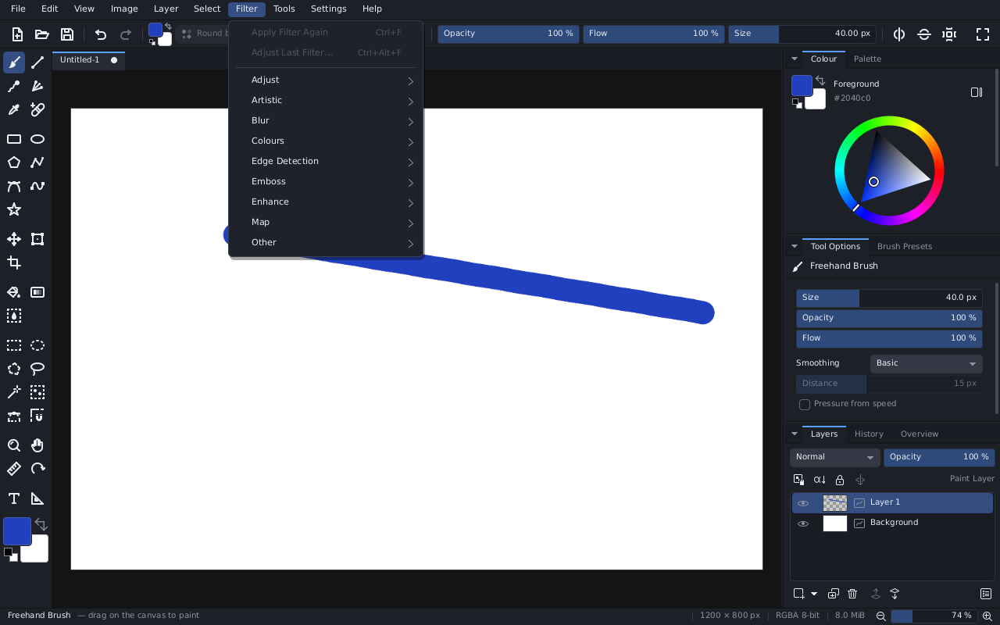
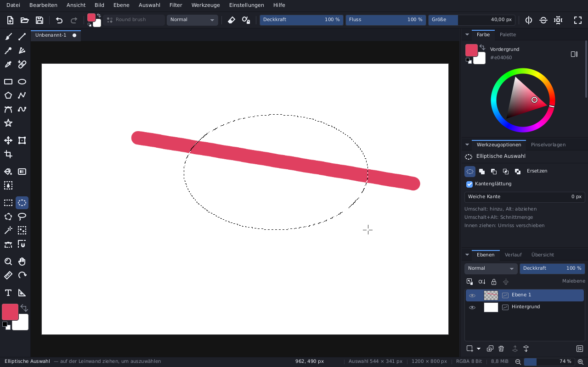

# Nebula

Nebula is the painting program of the Mlx desktop: layers, brushes,
selections, filters, transforms and the file formats painters use, in one
program written in Mlx on `std` alone. The same sources build one
standalone executable for each system: `nebula` for Linux, and
`--target=x86_64-brixos` for brixOS, where it runs on the native
interface (its bundle is
[`projects/desktop/apps/Nebula.app`](../desktop/apps/Nebula.app/app.ini),
id `org.mlx.nebula`, the program brixOS opens pictures with).

<table>
<tr>
<td width="50%"> 
<b>Menus.</b> The menu bar's lists come from the actions' tables; the
filters are grouped as their registry groups them.</td>
<td width="50%"> 
<b>German.</b> Every text is English and German (the locale, or the
setting); here the elliptic selection with its marching ants.</td>
</tr>
</table>

The picture above is brixOS's desktop in QEMU (1024 x 768). The others
are frames of `nebula --script` (no window; see
[Scripts](#scripts)). In a window on the desktop the bars and dockers are
the desktop's glass, as its other apps are; a script's picture has no
alpha, so it does not show that.

## What is there

- **Engine** ([`core/`](core/)): images of layers in 64 x 64 tiles that
  share memory until written (a copy is free, undo is the tiles kept);
  paint, group, fill, filter, clone, vector and file layers and masks;
  130 blend modes; the projection redrawn only where something changed;
  a history of named steps; selections as masks (combine, grow, shrink,
  feather, border); transforms (free, perspective, warp, cage, liquify,
  mesh); flood and enclose fill; gradients; palettes; a rasterizer for
  paths.
- **Brushes** ([`brush/`](brush/)): tips (automatic and predefined),
  sensors and curves for 24 options, smoothing and stabilizer, and the
  engines: pixel, eraser, smudge, clone, filter, deform, quick, sketch,
  spray, hairy, shape, particle, hatching, curve, grid, dyna.
- **Filters** ([`filters/`](filters/)): adjustments (levels, curves, HSV,
  colour balance, ...), blurs, sharpening and noise reduction, edges and
  emboss, artistic, map, gradient map, palettize; generators (noise,
  patterns, gradients).
- **Window** ([`ui/`](ui/), [`app/`](app/)): menu bar, toolbar,
  toolbox, document tabs, status bar, dock areas with tabbed dockers
  (colour, palette, tool options, brush presets, layers, history,
  overview, channels, histogram, grid, timeline), dialogs and a file
  dialog of its own, shortcuts and settings kept in
  `~/.config/mlx/nebula.conf`.
- **Tools** ([`tools/`](tools/)): brushes, shapes, selections, move,
  transform, crop, fills, gradient, colour sampler, smart patch, text,
  zoom, pan, measure, view rotation, assistants.
- **Files** ([`io/`](io/)): PNG, JPEG, WebP, BMP, TGA, PNM, QOI read and
  written; ORA, KRA, PSD, GIF and TIFF.
- **Animation** ([`core/animation.mlx`](core/animation.mlx)): keys on
  layers, holds, onion skin, PNG sequence export.

## Building and running

    ./mlx --quiet projects/nebula/main.mlx -o nebula
    ./mlx --quiet --target=x86_64-brixos projects/nebula/main.mlx -o nebula-brixos
    ./nebula

`./mlx build` builds it with the desktop (`mlx-out/bin/nebula`) and puts
it into the brixOS image as Nebula.app. `MLX_CANVAS=cpu` is what Nebula
draws with anyway (it says `nebula: drawing on the cpu`).

## Tests

    projects/nebula/test.sh            # all; or test.sh 01 32 ... by number
    tools/check_nebula.sh              # the tests, both builds, a script, a window

Every test is a program `tests/NN_name.mlx` that exits 13 when all is
well, built for Linux and for brixOS and run here. `tools/check_nebula.sh`
also plays a script without a window and drives the program in a window
under `tools/wayland-test-host`: the canvas shows, a stroke paints,
Ctrl+Z takes it back.

## Scripts

`nebula --script FILE` plays input without a window, one step a line:
`size W H`, `new W H RRGGBB`, `color RRGGBB`, `tool KEY`, `drag X0 Y0 X1 Y1
[STEPS]`, `click X Y`, `key Ctrl+Z`, `type TEXT`, `action KEY`, `wait MS`,
`german`, `expect X Y AARRGGBB`, `expect-note TEXT`, `shot FILE.png` and
more ([`app/script.mlx`](app/script.mlx) lists them). The pictures above
are made so.

## To do

Nebula is not finished. What is known to be open:

- [ ] **Five tests are red.** With the new mlx4 49 of the 54 tests pass.
      Open: 50_kit (does not compile for brixOS: the compiler limit
      below), 56_filedialog (crashes, signal 11, no crash report),
      57_chrome (51: the history docker's rows), 63_tools_transform (235:
      the script step `key Enter` fails; the test still has its
      reviewer's DEBUG lines) and 67_docker_color (237: the palette's
      scrolling). The others failed on tests that still expected the
      opaque docks, the menus before the real actions and formats before
      the layered ones, and one real overflow (the kit's slider, fixed).
- [ ] **Compiler: a limit near 3820 functions.** `--target=x86_64-brixos`
      refuses tests/50_kit.mlx (std/src/demangle.mlx:238 "return value
      does not match function type", then std/src/crash.mlx:1210) as soon
      as the program has 3821 functions or more ("functions discovered"
      without --quiet): with 3820 it builds, and one function added
      anywhere (`fn probeExtra(value: usize) -> usize { return value + 1 }`
      at the end of std/bootstrap/text.mlx) brings the error back. The
      old mlx4 does the same: not one of the four fixes, but a capacity
      in sema (the call resolves to the wrong type), to be found. Nebula
      itself builds for brixOS.
- [ ] **std.crash** prints no report for 56_filedialog's crash.
- [ ] **The colour body**: the colour panel to grow in the 3D shape (or a
      large view on a double click); drawing sharp takes some hundred
      milliseconds (coarse first, sharper while idle; analytic faces for
      the cubes; a GPU path once brixOS has Vulkan); the switch between
      OKLab and sRGB animated; tests for the Shift pick and the cut that
      follows the colour.
- [ ] **OKLab further**: the palette's nearest colour, the smudge engine's
      mixing and soft brush edges in OKLab.
- [ ] **Reviews of wave 4.** The tools, dockers, actions, layered formats,
      the further brush engines, the assistants and the animation are
      written; their adversarial reviews were stopped part way. Each
      package's test is to be run and its gaps read.
- [ ] **brixOS.** It runs there (the picture above: launcher, top bar,
      dock, painting); its window opens at 1280 x 800, larger than a
      1024 x 768 screen: it is to open at the screen's size. A check of its
      own (as `tools/check_brix_apps.sh`) is to come.
- [ ] **The desktop's look beyond its glass**: Comet has a header and a
      prism stripe; Nebula still has a classic menu bar and toolbar.
- [ ] **Canvas settings**: the ground's brightness, the checkerboard, the
      pixel grid and the cursor from the settings (canvasview still has its
      own).
- [ ] **Faster repaint while painting**: canvasview.refresh exists, the
      loop still draws the whole window (the status bar's pointer field
      has to come along).
- [ ] **Compiler, further:** 64-bit arithmetic does not trap on overflow;
      constant expressions that overflow their type compile; `<<` cuts the
      bits it shifts out; `std.io.printFmt` with an empty tuple does not
      link.
- [ ] **std**: std.fs's path locals take 4 KiB of the value arena a call
      (settings saves); `+| -| *|` were fixed for narrow types only.
