# Voyager

Voyager is the web browser of the Mlx desktop. Its engine is WebKit
2.54.1 on this repository's own port of it, PlatformMlx
([`projects/webkit/PORT.md`](../webkit/PORT.md)): WebCore, JavaScriptCore
and Skia compiled from WebKit's release as it is, with the port's own
files beside them, and built with nothing but this repository's
toolchain: mlx-cc compiles the C and C++, mlx-ar archives, the Mlx
compiler's linker links, and it runs on mlxlibc and mlxlibcpp, not on
glibc. Its window is Mlx ([`voyager.mlx`](voyager.mlx), std.ui's widgets
on the Wayland compositor), the engine's side is
[`engine.cpp`](engine.cpp). WebKit is the bootstrap: Voyager's own
engine, Lattice (WebKit translated to Mlx, then reshaped), comes later.

![A tour of Voyager: voyager://about; an address typed into the address
field loads a page of text, an image and a form; a new tab with a long
page scrolled by the wheel, another with planets on their orbits (CSS
animations on the compositor thread); the sidebar folded and opened;
the desktop switched to dark: the toolbar fades and the page follows in
its own dark design, then a page without one is forced dark; a download
with the progress ring round the toolbar's button and the popover
filling up to Done; voyager://version.](screenshots/tour.gif)

The pictures are of Voyager on the desktop's compositor, with the pages
of [`demo/`](demo/) served from this machine (and, in two of them, real
sites). [`tools/voyager_screenshots.sh`](../../tools/voyager_screenshots.sh)
takes them again (see [Pictures](#pictures)).

## Tabs and the sidebar

<table>
<tr>
<td width="50%">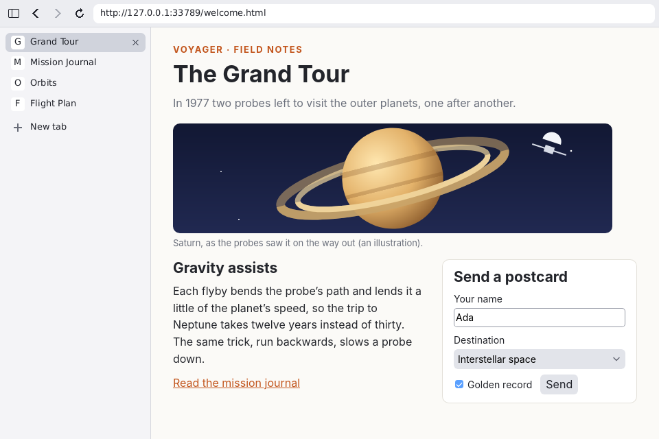<br>
<b>Tabs.</b> Each tab is a WebCore page of its own; the sidebar lists
them with their titles, a pulsing dot while one loads, its close button
and a row for a new tab. Tabs behind keep running.</td>
<td width="50%">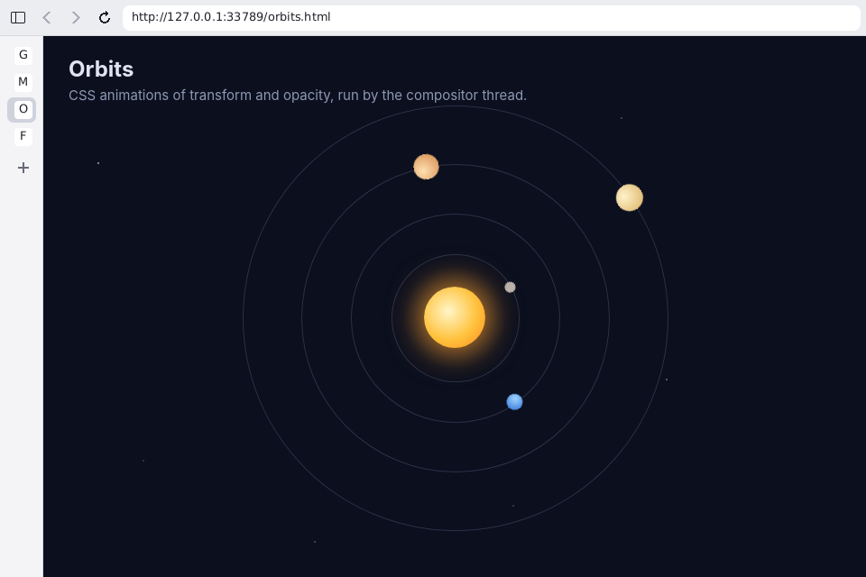<br>
<b>The sidebar folded.</b> Ctrl+Shift+B (or the toolbar's first button)
folds it to a strip of the tabs' initials and opens it again, gliding
both ways.</td>
</tr>
</table>

A tab a page opens (`window.open`, a `target=_blank` link) is shown at
once; a link opened with the middle button or Ctrl+click stays behind.
Closing the last tab closes the window.

Scrolling and CSS animations of `transform` and `opacity` run on the
compositor thread (PORT.md, M8): the wheel moves the page's layers without
painting it again on the main thread, and the animation above turns at
the display's rate (the tour shows both).

## The address field

<table>
<tr>
<td width="50%">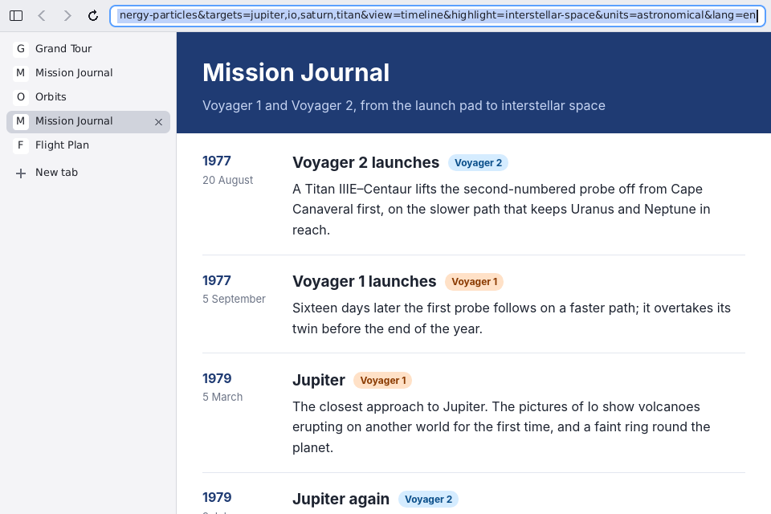<br>
<b>The address field</b> (std.ui.field) holds an address of any length,
scrolled to the caret: Ctrl+L or a click selects all of it, so typing
replaces it.</td>
<td width="50%">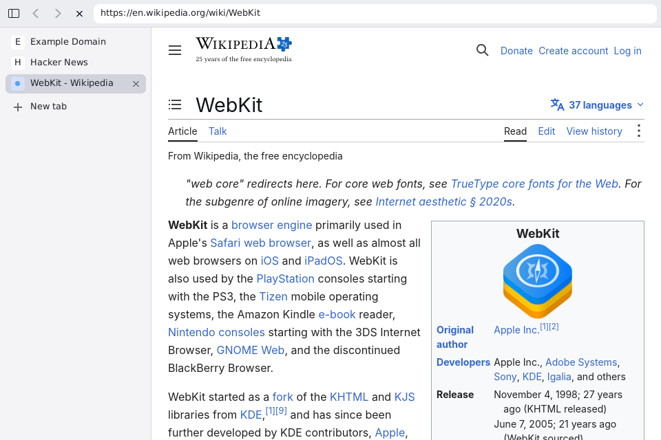<br>
<b>A real site.</b> Wikipedia's article on WebKit over HTTPS (std.tls),
with example.com and Hacker News in the tabs behind.</td>
</tr>
</table>

Enter loads what the field says; an address without a scheme is
`http://`, and `about:about` and `about:version` lead to Voyager's own
pages. Escape gives the keys back to the page. Ctrl+C, Ctrl+X and Ctrl+V
in the field, and Ctrl+C and Ctrl+V in the page, use the compositor's
clipboard.

## Light, dark and forced dark

<table>
<tr>
<td width="50%">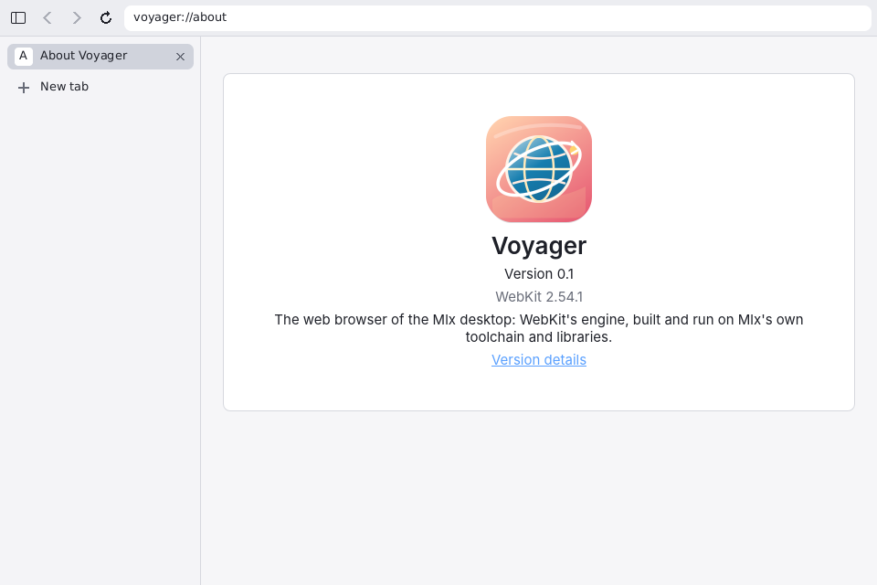<br>
<b>Light.</b> The toolbar and the sidebar are drawn in std.ui.theme's
look for the desktop's colour scheme.</td>
<td width="50%">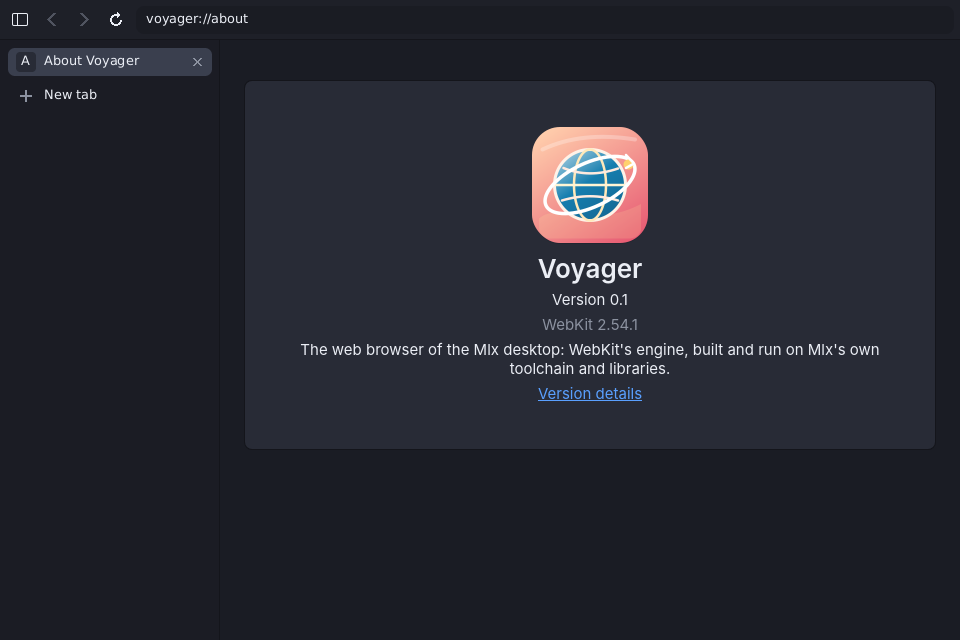<br>
<b>Dark.</b> The same on a dark desktop: Voyager's pages have a dark
design of their own.</td>
</tr>
<tr>
<td>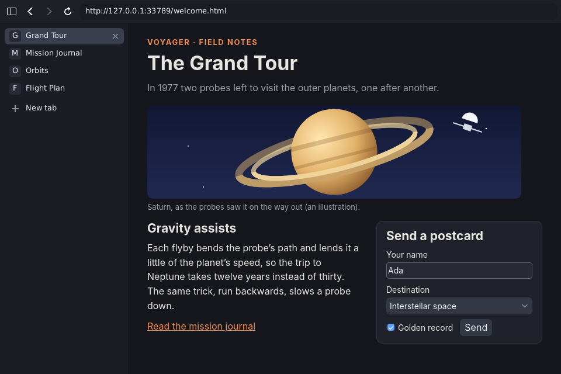<br>
<b>A page's own dark design.</b> On a dark desktop pages get
<code>prefers-color-scheme: dark</code>; this one has a dark design and
is shown in it.</td>
<td>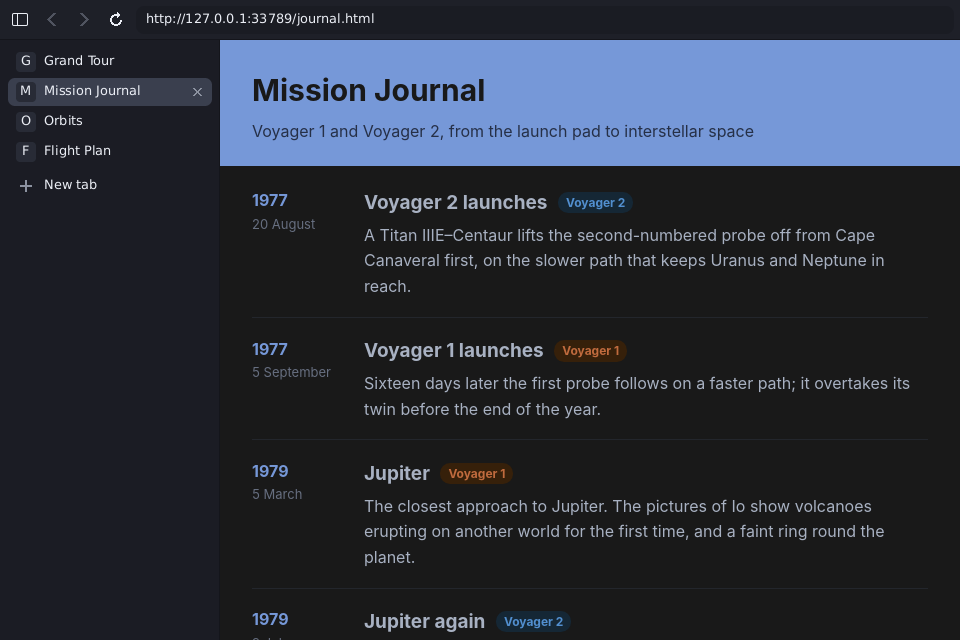<br>
<b>Forced dark.</b> A page without a dark design of its own is painted
dark by the engine, its colours' hues kept.</td>
</tr>
<tr>
<td>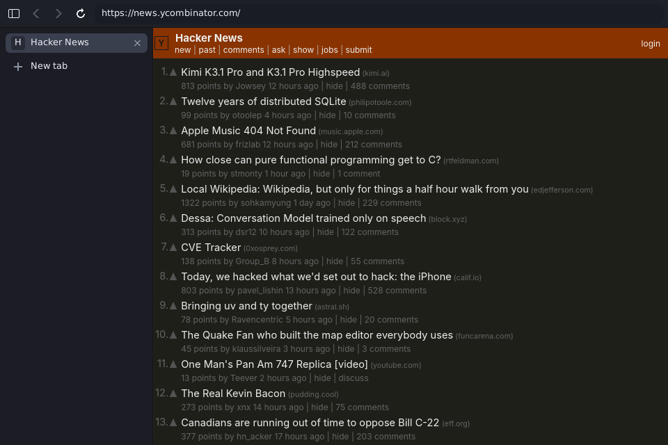<br>
<b>Forced dark on a real site:</b> Hacker News, which has no dark design.</td>
<td></td>
</tr>
</table>

There is no setting of Voyager's own for it: the scheme is the desktop's
(std.ui.appearance: `~/.config/mlx/appearance.conf`, which the Settings
app and the top bar write; `MLX_COLOR_SCHEME=dark|light` overrides it).
Switched while Voyager runs, the toolbar fades to it and the pages follow
at once, without a reload. On a light desktop pages are shown as they
are.

## Form controls in the port's theme

<table>
<tr>
<td width="50%">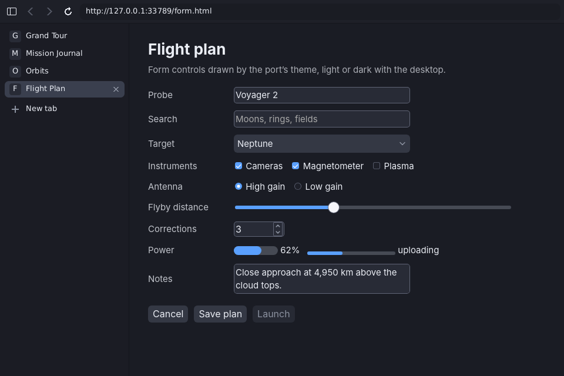<br>
<b>Form controls</b> are drawn by the port's theme
(<code>RenderThemeMlx.cpp</code>, <code>ControlFactoryMlx.cpp</code> in
<a href="../webkit/port">projects/webkit/port</a>) in std.ui.theme's
palettes, dark here on a page that allows both schemes.</td>
<td width="50%">The theme draws text fields, search fields, selects,
check boxes, radio buttons, sliders, number fields, meters, progress
bars, text areas and buttons in the look of the desktop's own apps
(std.ui.theme's colours and accent), light or dark: the first page of
the tour has the light ones.</td>
</tr>
</table>

## Downloads

<table>
<tr>
<td width="50%">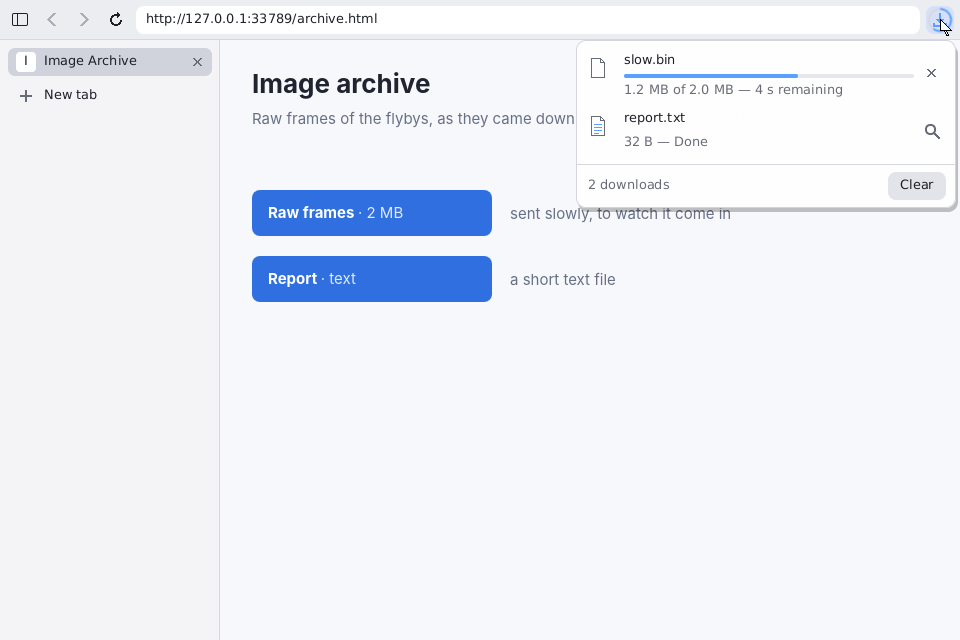<br>
<b>Downloads</b> are shown as Safari shows them: a button at the
toolbar's right end, with a progress ring round it while anything
downloads; its popover lists them, the newest first, with progress
and time left, then the size and Done.</td>
<td width="50%"></td>
</tr>
</table>

Downloads go to the desktop's download folder (`XDG_DOWNLOAD_DIR`,
`user-dirs.dirs`, else `~/Downloads`). In the popover a running download
can be stopped, a paused one resumed or cancelled, a finished one shown in
its folder (the desktop's Files) or opened with a double click; Clear takes
the finished ones off the list, their files stay. The list is kept in the
profile, so a restart finds it; `voyager://downloads` is the whole list.

## The file chooser

<table>
<tr>
<td width="50%">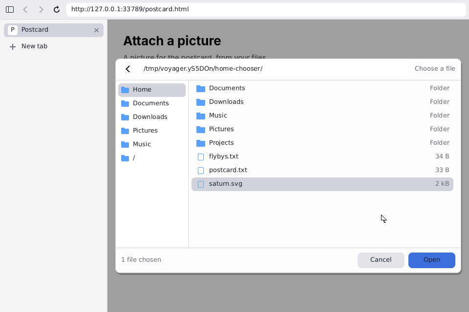<br>
<b>The file chooser.</b> A page's <code>&lt;input type=file&gt;</code>
opens std.ui.chooser over the page, with the places, a path field
that completes with Tab, and the folder it was last used in.</td>
<td width="50%"></td>
</tr>
</table>

## Internal pages

<table>
<tr>
<td width="50%">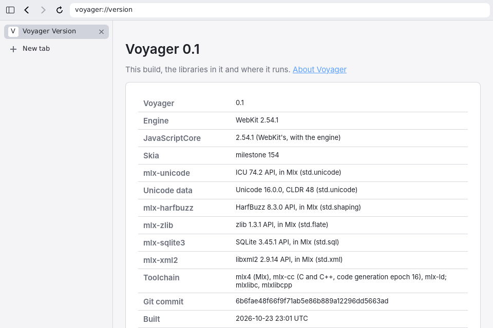<br>
<b>voyager://version</b> (or <code>about:version</code>): Voyager's
version, the engine's, every library in the build (each of them this
repository's), the toolchain, the commit, the user agent and where the
profile and the cache are.</td>
<td width="50%"><br>
<b>voyager://about</b> (or <code>about:about</code>), the page Voyager
starts with: its icon, version and engine.</td>
</tr>
</table>

| Page | What it shows |
| --- | --- |
| `voyager://` | the index of Voyager's pages |
| `voyager://about` | Voyager, its version and engine |
| `voyager://version` | everything about this build, as `chrome://version` |
| `voyager://downloads` | the downloads, with the popover's actions |

An unknown `voyager://` page is a 404 page. The pages are made by
[`pages.mlx`](pages.mlx), in the theme's light and dark colours.

## The user agent

```
Mozilla/5.0 (X11; Linux x86_64) Voyager/0.1 (WebKit 2.54.1; Wayland) AppleWebKit/605.1.15 (KHTML, like Gecko) Version/60.5 Safari/605.1.15
```

WebKit's compatibility string as its GLib ports build it, with Voyager's
product right after the platform, as Ladybird puts its own, and a comment
naming the engine and the window system (PORT.md, "The user agent").
`navigator.userAgent` and the requests' `User-Agent` header are the same.

## Keys

| Keys | What they do |
| --- | --- |
| Ctrl+T | a new tab, the address field taking the keys |
| Ctrl+W | close the tab shown (the last one closes the window) |
| Ctrl+Tab, Ctrl+Shift+Tab | the next tab, the one before |
| Ctrl+1 … Ctrl+8, Ctrl+9 | that tab, the last tab |
| Ctrl+L | the address field, all of it selected |
| Enter, Escape (in the field) | load the address; give the keys back to the page |
| Ctrl+Shift+B | fold or open the sidebar |
| Alt+Left, Alt+Right | back, forward |
| Ctrl+C, Ctrl+V | copy, paste (the compositor's clipboard; Ctrl+X too in the address field) |
| Middle click, Ctrl+click on a link | open it in a tab behind |
| Escape (popover open) | close the downloads popover |

## Building and running

```
./mlx build webkit-mlx-voyager       mlx-out/webkit/mlx/bin/voyager (and libvoyager.so)
voyager [--font FILE]... [--size WIDTHxHEIGHT] [--profile DIR] [--no-compositing] FILE|URL
```

The build compiles WebKit's sources (it takes a while the first time;
[`projects/webkit/README.md`](../webkit/README.md) says how many jobs
memory allows). Voyager runs on any Wayland compositor, the desktop's
own among them. Its profile (local storage, IndexedDB, cookies, the
downloads' list) is `~/.local/share/voyager`, its HTTP cache
`~/.cache/voyager`; `--profile DIR` puts both elsewhere.
`MLXWEB_CA_FILE=PATH` adds the certificates of a PEM bundle to the ones
it trusts.

`tools/install_compositor_session.sh` installs Voyager with the desktop
when it is built: `voyager` in `PREFIX/bin/mlx`, its desktop entry
(`org.mlx.voyager.desktop`, which the launcher lists; it takes `http`,
`https` and HTML files) and its icon.

`tools/check_voyager.sh` checks it on the compositor under
`tools/wayland-test-host`: pages, input, tabs, the scheme and forced
dark, internal pages, the profile, downloads, the file chooser,
composited scrolling and animations.

## Pictures

`tools/voyager_screenshots.sh [directory]` takes the pictures above again
(into `screenshots/` unless told otherwise). It needs Voyager built and
Python with Pillow; it builds only the compositor, the test host and
`tools/http-test-server`, which serves [`demo/`](demo/) (and its own
`/download/slow`, 2 MB over eight seconds, for the downloads). Each
scenario runs Voyager on the nested compositor under
`tools/wayland-test-host`, as `tools/check_voyager.sh` does: a script of
waits, keys, pointer moves and clicks, and `shot`s of the frames shown,
with the desktop's scheme set in a temporary `appearance.conf` (rewritten
while the tour runs for its switch to dark) or `MLX_COLOR_SCHEME`. The
tour is a `shot` every 100 ms (250 ms while the download comes in, shown
at twice the speed), made 800 pixels wide as they come; Pillow turns the
frames into PNGs and the tour into a GIF with one palette for all its
frames. It takes about four minutes.

`VOYAGER_SCREENSHOTS_WEB=1` adds the pictures of real sites
(`wikipedia.png`, `hn-forced-dark.png`; Voyager's environment is the
script's, so `MLXWEB_CA_FILE` reaches it). `VOYAGER_SHOTS_ONLY=tour`
(or `light`, `dark`, `chooser`, `downloads`, `web`) runs one scenario;
`KEEP_WORK=1` keeps the frames and the logs.
